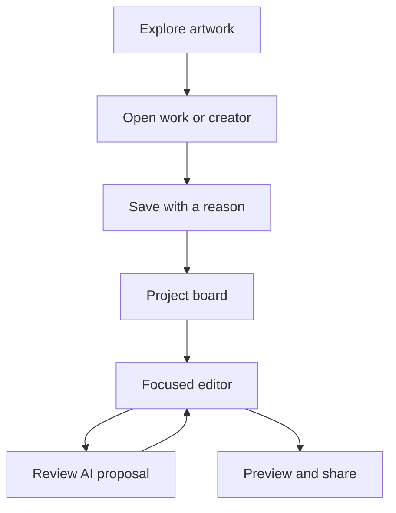

# The corrected project flow is hosted

People can now name projects before creation, choose whether a reference is collected or placed, and identify the project/layer being changed. Accepted source db5e4420407ce03e0a0c5fdddde99bb59d7fbbfc from [PR #26](https://github.com/Pukujan/kresilo/pull/26) is live at https://kresilo.design-bakery.com. [Six Mermaid maps](docs/user-flows.md) explain discovery, creation, reference correction, prompting and sharing with route/command mapping.

The board separates references from current artwork and provides rename, copy, reversible removal and restoration. Existing-project placement defaults to a separate layer; background replacement is explicit. The mobile drawer stays open during asset selection, and prompting requires an actual target. Session-bound response guards, saved-revision reconciliation, serialized profile preferences, focus return and dark-mode contrast protect the flow. Private imported filenames are excluded from publication credits.

Required MacBook Pro source checks pass on the final push and merge candidate, including 85 tests. Seventeen spare-port preflight checks pass before the switch. Through HTTPS, seventeen project/reference checks, eighteen history checks and twenty-one layered/model checks pass. The last suite uses a real focused provider proposal and verifies no artwork change before approval, accepted persistence and guest isolation. Public entry bytes match the host build. Browser checks verify named creation, mobile layer selection, prompt target consistency and refresh; configuration bytes match the previous release and rollback remains available. [Hosted acceptance](docs/qa/project-flows/hosted-project-flow-acceptance.json) preserves exact identity and limits.

Leaf #20; parent #12 then #1; dependencies accepted #14/#15/#18 and setup #8. Task KRES-0010; writer Codex; evidence branch `codex/project-flow-release-evidence`. [Live release scope](https://github.com/Pukujan/kresilo/issues/20#issuecomment-6348590303). This report increment's required checks and accepted merge remain pending as of this entry. Google sign-in and native phone hardware remain unverified; video export was not rerun for this UI follow-up. Copy then remove is two explicit actions, and invitations grant edit/comment access rather than task responsibility. No configuration change, migration, research write or second database. Next: verify the final evidence increment on required checks and accepted history; no further service mutation is needed.

# Kresilo presentation prototype is live

## Latest hosted update on October 22, 2026

The live site now serves accepted source [e106f4f](https://github.com/Pukujan/kresilo/commit/e106f4ffc173d69407d411e459b0a3979314bb15) from [profile and spelling PR #24](https://github.com/Pukujan/kresilo/pull/24). This includes the accepted layers/assets, focused prompts, discovery filters, dark mode, mobile bottom drawer, Undo/Redo, Versions and six motion references. The main header has a visible Profile shortcut; project and work headers have a direct own-profile icon. The wordmark displays exact Kresilo text in the existing italic typeface. Six fictional creators and sixteen sample works are available.

The public entry matches the accepted host build byte for byte. Required final-head and merge-candidate MacBook Pro checks pass with 71 tests. Through HTTPS, 25 layered/model/export assertions and 18 history assertions pass, including approval without early mutation, refresh, immutable restore and guest isolation. A new layered MP4 is H.264, 540 × 720 and two seconds. Live desktop/mobile checks verify profile navigation, exact lettering, reference → Studio, the drawer and Studio → own profile. Studio at 320 pixels and profile at 390 pixels have no horizontal overflow.

The previous release and service configuration remain available for rollback. Existing port, hostname, tunnel routes and server-only credentials are preserved. No research writes or database migrations were needed. An initial bootstrap failed; the previous service was recovered, and a subsequent normal service reload installed the release. Interruption duration was not measured; zero-downtime deployment is not claimed. The verified preflight process is stopped.

[Release identity](docs/qa/layered-workspace/hosted-release-acceptance.json), [25 layered checks](docs/qa/layered-workspace/hosted-layered-acceptance.json), [real layered MP4](docs/qa/layered-workspace/hosted-layered-export.mp4), and [live mobile profile](docs/qa/layered-workspace/mobile-profile-navigation.png) preserve evidence. The raw API report alone does not establish deployment; the separate identity record does. Native phone hardware and Google sign-in remain unverified; private imported canvas media remains blocked from publication.

Leaf [#20](https://github.com/Pukujan/kresilo/issues/20); parent #12 then #1; dependencies accepted #14/#15/#18 and deployment setup #8. Task KRES-0010; writer Codex; evidence branch `codex/hosted-release-evidence`. Owner authority: [profile/deployment direction](https://github.com/Pukujan/kresilo/issues/20#issuecomment-6346918866) and [spelling correction](https://github.com/Pukujan/kresilo/issues/20#issuecomment-6347025421). This report increment still needs required CI/merge; the live issue owns later receipt-only transitions.

## Earlier release record

The following sections retain their original source and test limits.

The owner-approved simple creative workspace is running at [kresilo.design-bakery.com](https://kresilo.design-bakery.com). Guests can discover original sample work, save a reference with a reason, make an approved change, export motion and create a credited private preview. Guest work resumes in the same browser for up to thirty days while its cookie remains present.

This report covers the accepted implementation merge [b636415](https://github.com/Pukujan/kresilo/commit/b6364152f8e95df8ff13968d2f4aff1ea5e990e6), delivered through [implementation PR #11](https://github.com/Pukujan/kresilo/pull/11). It records observed tests on October 22, 2026 UTC. The report's own documentation increment still needs required CI and merge; its current status belongs to the [delivery issue](https://github.com/Pukujan/kresilo/issues/16).

Work-owning leaf [#16](https://github.com/Pukujan/kresilo/issues/16), task KRES-0007; parent #12 → #1; dependencies #13/#14/#15/#17/#18 and original #7/#8. Writer Codex, branch `codex/kresilo-prototype`. Scope follows the [owner's simpler-workspace correction](https://github.com/Pukujan/kresilo/issues/12#issuecomment-6324889239). The [deployment receipt](https://github.com/Pukujan/kresilo/issues/16#issuecomment-6332018141) separates accepted source, host observations and remaining setup.

## What people can use

Navigation stays at Explore, Projects and You, with a Create action. Discovery scrolls from artwork to culture stories and a gallery. Three clearly fictional creators have consistent profiles, portraits, work and source credits. Place, following and explicit taste influence recommendations; saved project references take priority. The sample collection has ten works, three editable starters and three original four-second motion loops.

The Studio offers focused text and colour controls, reference-based proposals, history and immutable version restore. Quick cuts, Type punch and Collage shuffle join the quieter motion choices. Export creates an actual H.264 MP4 and stores its authenticated media in Octo. An exported result reopens after navigation or refresh. Browsing loops have pause controls and respect reduced-motion settings.

The tested journey is the same on desktop and mobile:

1. Explore artwork or a creator and save a reference with its reason.
2. Open the project board, then its focused editor.
3. Review a proposal; artwork changes only after approval.
4. Open motion, history or a credited preview when needed.

For a presentation, start at the homepage, open a work and save it, then choose Make. Request “Use quick cuts for a four-second loop.” Approve the proposal, open Motion and export. Preview creates an unlisted link; anyone receiving that link can see the frozen public-safe snapshot. The board, saved reasons, prompts and comments remain private. Community publication is a separate explicit choice.

## Evidence and limits

| Check | Observed result |
| --- | --- |
| Approved visual direction | Twenty matched source/render comparisons pass in [design-qa.md](design-qa.md). Source states include scrolling and overlays, not twenty separate destinations. Minor font weight, icon stroke and proposal-thumbnail polish remain. |
| Responsive layout | Local desktop, tablet and mobile checks pass at 1487 × 1058, 768 × 1024, 390 × 844 and 320 × 740. Hosted desktop and mobile pass without horizontal overflow. Native Safari/iOS is untested. |
| Guest persistence and ownership | Real Octo checks pass resumed projects, cross-guest denial, required reasons, stale-write conflicts and media ownership. No in-memory persistence fallback is claimed. |
| Approval and history | Proposals remain inert before approval; repeated approval is idempotent. Restore appends a version and preserves later history. Invited sessions can comment. |
| Publication privacy | Private previews redact project internals. The HTTPS mobile journey created a credited preview and confirmed the Copy link toast. |
| Multimodal model | Real image, imported-video and fast-motion requests succeeded through Inferhub using `ali/qwen3.8-omni-flash`. A separate earlier request used the labelled prototype fallback; universal provider reliability is unproven. |
| Motion export | All three fast presets have decoded, visibly different frame samples. A fresh MacBook Pro export is four-second H.264, 540 × 720, with three distinct decoded samples. A second export through HTTPS survived mobile refresh and played to its four-second end. |
| Research boundary | All twelve research-table counts and content fingerprints match the prior baseline. Additive runtime migrations affect only `kresilo_demo` in the existing workspace. |
| Application checks | The pinned repository verifier passed governance, frozen dependency installation, lint, typecheck, 62 tests and production build. Lint warnings are recorded, not zero-warning claims. |

Machine-readable results: [local acceptance](docs/qa/simple-workspace/acceptance.json), [hosted acceptance](docs/qa/simple-workspace/hosted-acceptance.json), [twenty-view mapping](docs/qa/simple-workspace/views.json). Hosted screenshots: [homepage](docs/qa/simple-workspace/hosted-homepage.jpg), [gallery](docs/qa/simple-workspace/hosted-gallery.jpg), [mobile Studio](docs/qa/simple-workspace/hosted-mobile-studio.jpg), [restored export](docs/qa/simple-workspace/hosted-mobile-export.jpg), [private preview](docs/qa/simple-workspace/hosted-mobile-preview.jpg).

## Accepted source and hosting

Both [push CI](https://github.com/Pukujan/kresilo/actions/runs/39715007703) and [pull-request CI](https://github.com/Pukujan/kresilo/actions/runs/39715011871) passed the repository/application job and required `gates` job on the dedicated MacBook Pro runner. The pull-request checkout tested merge candidate `0e76b6839e6517bf72ccc5a1e6c504feb3dd1f2f` against base `2f386e2`. Auto-merge was requested after final push `8c0867ed501ce51deb300542e703005634e262fe`; the accepted merge has the same tested tree. The [merge receipt](https://github.com/Pukujan/kresilo/issues/16#issuecomment-6331825194) records the exact revisions and checks.

The accepted artifact runs from a separate release directory on the MacBook Pro. The earlier builder checkout, including its dirty generated output, is preserved. The previous service configuration is backed up privately. The existing hostname, service port and Cloudflare tunnel route are unchanged. The served entry asset matches the accepted build byte for byte. The temporary preflight process was stopped after its identity was verified.

React 19, TypeScript, Vite, Tailwind/shadcn/Radix and Nitro remain the application stack. The renderer uses HyperFrames and GSAP with a fixed trusted composition. OpenDesign informed the bounded renderer integration; its entire application and separate database were not adopted. Licences and attribution are in [THIRD_PARTY_NOTICES.md](THIRD_PARTY_NOTICES.md).

## Remaining setup

Google credentials have not been submitted through the private local form, and live Google sign-in is unverified. The interface says so and keeps the owner-approved guest path available. Account setup stays open in [#13](https://github.com/Pukujan/kresilo/issues/13). Clearing cookies removes guest access; cross-device guest recovery is not implemented.

The attached Kristello connector needs reauthentication; the tested server-only workspace access works. Ideogram, Krea and Higgsfield are not connected. There is no claim of a full social network, arbitrary design-code execution, unrestricted canvas editor, native application or finished commercial product. Lina Guerrero's portfolio supplied motion direction; no portfolio footage was copied.

Next: verify required MacBook Pro checks and accepted history for this report increment, then record the final receipt on the delivery issue. Google setup needs the owner's credential submission and a real sign-in test before it can be called connected.
