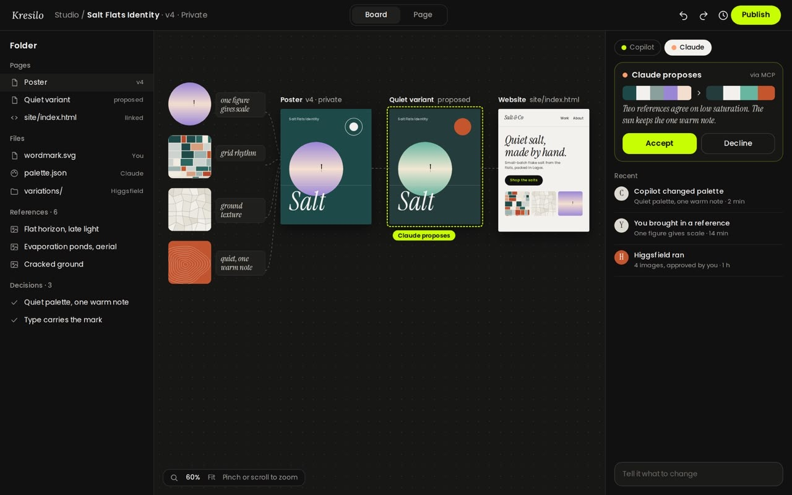

# Kresilo

A designer brings a Salt Flats reference into a project because “one figure gives scale.” Later, the poster changes. Kresilo explores how to keep **the reference, its reason and the accepted decision** connected to that work.

This repository contains a responsive web prototype for reviewing that idea with Kresilo’s founders. Its scope is a homepage and one **Salt Flats Identity Studio** workflow: add a reference with a reason, review a proposed direction, approve or decline it, and inspect the resulting artwork, decision, version and private preview.



*Original design target, not a screenshot of the implemented prototype.* Source and owner clearance are recorded in the [asset inventory](docs/asset_inventory.md).

## What it does today

Updated with every pull request; the [changelog](CHANGELOG.md) has the detail.

**Find work and people**
- Home is one feed of works. Every seventh card is an open board you can join.
- Discover (`/search`) holds culture stories, events and curated collections.
- Thirty makers, each with a persona, a portrait and their own style. Follow them and save works to your collection (`/me`).
- Case studies, asset libraries and templates. Templates are editable layouts with variants, including album covers and anime posters.
- Events (`/events`): in person, online and hybrid, listed by date with where each is held. Register, add to your calendar, and host your own; Going and Hosting keep your plans.
- Boards (`/boards`, `/projects`): your boards, team boards and open public boards.

**Start something** (`/create`)
- Type an idea, optionally starting from an upload (image or PowerPoint), a work you like, or a template.
- The project names itself from the idea, and Studio opens with the assistant already working on it.

**Studio** (`/studio/:id`)
- Canvas: poster, story, square or wide, sized to fill the screen, with zoom (buttons, slider, pinch, ctrl or cmd + scroll). A canvas colour, and a photo background with filters.
- Layers: images, text, shapes and hand drawing. Lock, hide and reorder them.
- The AI assistant edits words, layout, look and images. You choose what it may change, it can focus on one layer, and every change is a proposal you approve or decline. References are cited when present but not required.
- The sticker maker makes a die-cut sticker from a few words, in the background.
- Undo and redo, version history, a basic motion timeline with export, presentation playback, and publishing with audience and culture details.

**Account**: start as a guest in one tap (projects kept for 30 days), English, Spanish and Arabic, and a light or dark theme. Google sign-in is built and ready to switch on.

**Not yet**:
- Figma and Canva import (they need the owner's API access).
- Open boards and comments for real users (they need migrations 006–010 on the live database).

## Current prototype

The prototype is deployed at `https://kresilo.design-bakery.com`. The homepage and Studio render on desktop and mobile, and the full workflow has been exercised in a browser against live storage: a proposal is created without touching the board, approval repaints the poster and writes the decision, version and history, and the result survives a refresh. The [live verification](docs/live-verification.md) records that run; the branch is [draft PR #11](https://github.com/Pukujan/kresilo/pull/11).

The existing Kristello workspace stores demo records separately from its research material. [Direct database checks](docs/database-verification.md) passed 26 workflow assertions, including isolated guests and atomic approval.

Older note, closed on October 22, 2026: the first Studio had its own command route, session route and text Copilot. Those are removed (`/api/command` and `/api/session` now answer 410 and touch no storage), so `/api/creative` is the only route that accepts project writes. The image-reference assistant in `server/creative/assistant.ts` reads `INFERHUB_API_KEY` only in `server/`; the key never reaches the browser bundle.

Figma, Canva, Higgsfield, Paper and Claude are not connected. A private publish preview does not publish a project to another service. Native apps remain outside this build.

## Review locally

Use Node.js 24 and pnpm with the committed lockfile:

```sh
pnpm install --frozen-lockfile
pnpm dev
```

Open `/` for the homepage and `/projects` for the workspace (`/demo` redirects there). Project changes need a server credential; without one nothing is saved.

The deployment target is `https://kresilo.design-bakery.com` (owner correction, October 18, 2026), served from the owner's MacBook Pro. The GitHub repository remains private.

For implementation and acceptance, read the [handoff](HANDOFF.md), [build plan](BUILD_PLAN.md), [original designs](DESIGN_ASSETS.md), and [Kristello boundary](KRISTELLO_GUIDE.md). Progress and remaining acceptance belong to [issues #2–#8](https://github.com/Pukujan/kresilo/issues).
