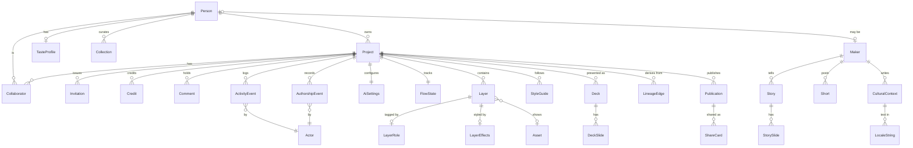

# Planned data models (PROPOSAL, not accepted scope)

Status: draft for owner review, October 22, 2026. Lineage: parent leaf #29, then #12 and #1. Owner direction (October 22, 2026): use proper file, folder, module and versioning management, metadata and a manifest so files do not fly everywhere, with the data models planned ahead.

Labels: **observed** = read in the repository at `origin/main` 8bba7d9 (or on a named branch) on October 22, 2026; **inference** = my reading, not tested; **proposal** = does not exist unless named as existing. No Octo query was run for this document, so no row count or live schema is claimed beyond what the migration files in `db/migrations` say.

## The problem and what this changes

The next phase adds a lot of new data (who made what, credits, makers, stories, style guides, decks, AI settings) across a dozen open issues. Without a plan each issue would invent its own shape, put it somewhere different and name it differently. This document and `src/models/` fix the shape, the owner, the home and the version of each model before anyone builds it. Nothing here changes running behaviour: the registry is not imported by the app (a test enforces that), there are no migrations in `db/migrations`, and no database was touched.

Three artifacts, one source each:

| Artifact | What it is | Source of truth for |
|---|---|---|
| This file | The plan in words, the diagram, privacy and migration order | Intent and decisions |
| `src/models/*.ts` (+ `index.ts` registry) | One zod schema per entity, with version, status, issue, storage | Exact field types and rules |
| `docs/models.manifest.json` | Generated list: name, version, status, issue, storage, file | What exists, for tools and review |

`src/models/README.md` holds the folder rules. `pnpm models:manifest` regenerates the manifest; `tests/models-registry.test.ts` and `tests/models-rules.test.ts` check the registry, the manifest, the rules below and that nothing is wired in.

## Ground rules (apply to every model)

1. **Storage is additive and inside the existing Octo workspace.** Allowed homes: inside the project JSON document (`kresilo_demo.creative_projects.document`), inside the publication document, a new `kresilo_demo` table, or additive columns on an existing `kresilo_demo` table. No second database. `kresilo_research` stays read-only and is never a home. Observed: the app's Octo guard allows only `SELECT kresilo_demo.some_function(...)` (see `docs/octo-reach-test.md`), so every new table also needs owner-run SQL functions with the same session checks as `creative_get` and `creative_save`.
2. **The project document has a size cap.** Observed in `db/migrations/003_creative_workspace.sql`: `creative_save` rejects a document over 2,000,000 bytes. Anything that grows without bound (authorship events, activity) goes in a table, not in the document.
3. **Private by default.** A record is private to its owner and collaborators until the owner chooses an audience. Only the fields listed under "may become public" ever reach a published page, and a published page is built from stored records, never from free text the page did not store.
4. **AI is never recorded as hand work, and never authors culture.** `origin` is a closed list (`hand`, `ai-assisted`, `ai-generated`); `CulturalContext.authoredBy` is the literal `maker`.
5. **Strict shapes.** Unknown fields are rejected, strings and numbers are bounded, ids are uuids, times are ISO strings, and nothing a person or model returns can become executable CSS or HTML.

### Versioning rule

Each model has a semver `version`; each stored document carries `schemaVersion` with the same **major**. Readers accept any document of the model's major.

| Change | Bump |
|---|---|
| New optional field, enum value readers can ignore, looser bound | minor |
| Fix that does not change what parses | patch |
| Required field added, field removed or renamed, enum value removed, tighter bound, changed meaning | **major**, with a written migration |

Planned models are `0.x.y`; a model that is in use is `1.0.0` or higher. Today the project document has no `schemaVersion` (observed: the `Project` type in `src/creative/contracts.ts`). Proposal: the first write after a model goes live adds it; a missing value means the baseline shape described under "Observed baseline".

## Observed baseline (what is live)

The live tables, from the migration files:

| Migration | Tables in `kresilo_demo` |
|---|---|
| `001_kresilo_demo.sql` | `sessions`, `projects`, `references`, `proposals`, `approvals`, `decisions`, `versions`, `history_events`, `preview_selections` (the older write path) |
| `003_creative_workspace.sql` | `creative_people` (profile jsonb), `creative_sessions`, `creative_projects` (document jsonb, revision), `creative_members` (project, person), `creative_invites` (token hash, expiry, used by), `creative_publications` (audience, document) |
| `004_creative_media.sql` | `creative_media` (image or video as base64 text, per project) |
| `005_motion_jobs.sql` | `creative_motion_jobs` (state, media id) |

The live project document (`Project` in `src/creative/contracts.ts`) holds: `title`, `brief`, `art` (title, caption, colour, size, position, asset, background, `layers[]` up to 12), `motion`, `references[]`, `referenceArchive[]`, `proposals[]`, `versions[]`, `history[]` (`actor` is one name string), `comments[]`, `decisions[]` and `mode` (`guided`, `explorer`, `advanced`).

Live on `origin/main`: non-destructive layer effects (crop, mask, shadow, blend, flip, adjust), commit 8bba7d9, #54. Implemented on unmerged branches, not on main: layer `role` (commit c23dfbe) and `aiLock` (commit e3869ef) on `claude/smart-layer-names`; `Project.aiApply`, the `project.ai` command and `Suggestion.targets` on `claude/ai-auto-apply`.

## Overview



Text version of the same relations: a **Person** owns **Projects** and may be a **Maker** (a sample maker is never a Person). A Project has Collaborators and Invitations, Credits, Comments, an append-only stream of **AuthorshipEvents** and **ActivityEvents** (each by an **Actor**), one **AiSettings** and one **FlowState**, Layers (tagged by **LayerRole**, styled by **LayerEffects**, showing an **Asset**), **StyleGuides**, **Decks**, **LineageEdges** to the works it was made from, and **Publications** (each with **ShareCards**). A Maker has **Stories**, **Shorts** and **CulturalContext**. **LocaleString** is the text type inside Story, CulturalContext, Maker and Deck. Person, Project, Layer and Publication are live and not in the registry; the rest are.

## Registry at a glance

| Model | Version | Status | Issue | Lives in |
|---|---|---|---|---|
| ActivityEvent | 0.1.0 | planned | #52 | new table `activity_events` |
| Actor | 0.1.0 | planned | #41 | embedded |
| AiSettings | 0.1.0 | planned | #51 | project document (`aiApply` is on a branch) |
| Asset | 0.1.0 | planned | #39 (storage #44) | new table `assets` |
| AuthorshipEvent | 0.1.0 | planned | #50 | new table `authorship_events` |
| BrandTemplate | 0.2.0 | planned | #47 | new table `brand_templates` |
| CaseStudy | 0.1.0 | planned | #37 | new table `case_studies` |
| Collaborator | 0.1.0 | planned | #36 | extends `creative_members` |
| Collection | 0.1.0 | planned | #48 | new table `collections` |
| Comment | 0.1.0 | planned (extends a live shape) | #36 | project document |
| Credit | 0.1.0 | planned | #36 | project document |
| CulturalContext | 0.1.0 | planned | #48 | new table `cultural_contexts` |
| Deck (with DeckSlide) | 0.1.0 | planned | #47 | new table `decks` |
| FlowState | 0.1.0 | planned | #40 | project document |
| Invitation | 0.1.0 | planned | #52 | extends `creative_invites` |
| LayerEffects | 1.0.0 | **live** | #53 | project document |
| LayerRole | 0.1.0 | planned (implemented on a branch) | #53 | project document |
| LibraryAsset | 0.1.0 | planned | #37 | new table `library_assets` |
| LineageEdge | 0.1.0 | planned | #39 | new table `lineage_edges` |
| LocaleString | 0.1.0 | planned | #49 | embedded |
| Maker | 0.1.0 | planned | #38 | new table `makers` |
| ShareCard | 0.1.0 | planned | #43 | publication document |
| Short | 0.1.0 | planned | #37 | new table `shorts` |
| Story (with StorySlide) | 0.1.0 | planned | #37 | new table `stories` |
| StyleGuide | 0.1.0 | planned | #47 | new table `style_guides` |
| TasteProfile | 0.1.0 | planned | #51 | new table `taste_profiles` |
| UsageEvent | 0.1.0 | planned | #52 | new table `usage_events` (migration 009) |

Not in the table because they are live and unchanged: Person, Project, Reference, Suggestion (proposal), Decision, Version, Publication. Extensions to live models are described in "Extensions to existing live models" below.

## The models

Each section gives: purpose, fields, relations, where it lives, privacy and notes. Field types follow the zod schema in `src/models/`; that file wins if they ever differ (a test checks the status and version lines below against the registry).

### AuthorshipEvent

Status: planned, version 0.1.0, issue #50.

**Purpose.** One small text record of who did what, with which tool, for which step, and whether it was kept. It is how a viewer can see exactly where AI did and did not help. Observed: history stores only the person's name, so an approved AI change looks like a hand edit.

| Field | Type | Notes |
|---|---|---|
| id, projectId | uuid | |
| versionId | uuid, optional | The version this event produced |
| at | ISO time | |
| actor | Actor | Who acted (the approver, for an AI step) |
| origin | `hand` or `ai-assisted` or `ai-generated` | Closed list |
| tool | text (80) | "by hand", "Copilot (prototype guidance)", "Claude through MCP", "unknown AI tool" |
| model | text (80), optional | Only for AI origin |
| step | `reference`, `proposal`, `layer-edit`, `motion`, `import`, `decision`, `style`, `deck`, `publish` | |
| outcome | `accepted`, `edited`, `declined` | |
| subject | kind (`layer`, `title`, `background`, `motion`, `version`, `decision`, `reference`, `asset`) and optional id | |
| proposalId, assetId | uuid, optional | |
| corrects | uuid, optional | A new event that fixes an older one; the older one is never rewritten |
| note | text (300), optional | |

**Rules, enforced by the schema.** Hand work is made by a person, uses the tool "by hand", names no model and has no proposal behind it. AI work can never use the tool "by hand". An event cannot correct itself.

**Relations.** Belongs to a Project; versions, decisions and ActivityEvents point at events by id. Declined AI options keep only a thumbnail reference (an Asset), a hash and metadata unless the artist pins them.

**Lives in.** A new table, append-only (proposal). Why not the document: events are many and the document is capped at 2 MB (observed). A share of hand against AI work is computed from a written formula (the open deliverable of #50) and always labelled an estimate; it is not stored.

**Privacy.** Private. A published page shows the authorship strip, summarised or full, and it cannot be turned off.

### Actor

Status: planned, version 0.1.0, issue #41.

**Purpose.** Names who performed an action: a person, the Copilot, an MCP agent, an import or the system. Lets the one typed command service record every caller, which is what makes #41 (MCP access) and the activity feed honest.

Fields: `kind` (`person`, `copilot`, `mcp-agent`, `import`, `system`), `personId` (required for a person), `label`, `tool` (required for an MCP agent, for example "Claude through MCP").

**Lives in.** Embedded in AuthorshipEvent and ActivityEvent. **Privacy.** Shown to collaborators; a published page shows labels, never person ids. **Note.** Which MCP harnesses exist (for example "Hermes") is unverified.

### Asset

Status: planned, version 0.1.0, issue #39 (storage side #44).

**Purpose.** An image or video stored once and identified by the SHA-256 of its bytes, so the same file used twice, or in two projects, is one record. Also holds where it came from and the right claimed.

| Field | Type | Notes |
|---|---|---|
| id | uuid | |
| contentHash | 64 hex characters | Identity for de-duplication |
| contentType | `image/jpeg`, `image/png`, `image/webp`, `video/mp4` | Same list as the live `media.import` |
| byteLength | integer, up to 25,000,000 | |
| width, height | integer, optional | |
| name | text (80) | |
| ownerId | uuid | |
| source | kind (`upload`, `import`, `generated`, `sample`, `export`), `creator`, `sourceUrl` (https), `right` (`own-work`, `licensed`, `permission-given`, `public-domain`, `unknown`), `tool`, `model` | Generated media names its tool |
| storage | kind (`database-base64`, `object-storage`, `bundled`) and key | Object storage needs a key (#44) |
| derivedFrom | uuid, optional | Crop export, render |
| visibility | `private` or `community` | |
| publishable | boolean | Must be false when the right is `unknown` (fail closed) |
| firstSeenAt | ISO time | |

**Lives in.** A new table `assets` whose rows point at the existing `creative_media` row while bytes stay in the database; #44 later moves bytes to object storage. Observed: media is a base64 row per project with no hash, about 537 kB per image on average and 20 MB across 36 rows in the October 22 read-only test (`docs/octo-reach-test.md`, agent report). Exact duplicates use the hash, not embeddings.

**Privacy.** Private by default. A private imported image is never published (observed publication guard).

### LineageEdge

Status: planned, version 0.1.0, issue #39.

**Purpose.** "This project was made from that work", used for "Made from N references" and "Used in". Built only from stored records (a kept reference with the designer's reason), never from image similarity.

Fields: `id`; `fromWorkId` (catalog id or publication id); `fromSample`; `toProjectId`; `toSample`; `referenceId` or `assetId`; `kind` (`kept-reference`, `carried-reference`, `used-asset`); `reason` (the designer's own words, as stored on the reference); `visibility`; `createdAt`.

**Rules.** Sample works link only to sample works (`fromSample` equals `toSample`). A reference edge needs `referenceId`; `used-asset` needs `assetId`.

**Lives in.** A new table `lineage_edges`. **Privacy.** Follows the target project: a private project never appears in another work's "Used in". The reason stays private unless the designer chooses to disclose it.

### Credit

Status: planned, version 0.1.0, issue #36.

**Purpose.** One line of credit on a project, in one of three kinds kept apart: **made-by** (owner and confirmed collaborators, with roles), **referenced-work** (makers whose work was kept as a reference) and **made-with** (tools, never given a role). Observed: credits are rebuilt from references at publish time as "With a reference from {creator} · {title}" and carry no roles or confirmation.

Fields: `id`, `projectId`, `kind`, `displayName`, `personId` or `makerId`, `sourceWorkId` (referenced-work), `tool` (made-with), `roles` (`lead`, `design`, `type`, `motion`, `feedback`; up to five, unique), `status` (`pending`, `confirmed`, `declined`, `withdrawn`), `confirmedAt`, `sample`.

**Rules.** Only made-by carries roles, at least one, and names a person or maker. Made-with names its tool. Referenced-work names its source. A person's name is published as a collaborator only while `confirmed`.

**Lives in.** The project document as `Project.credits[]`, copied into the publication at publish time (inference: small, and it must travel with the publication snapshot). **Privacy.** Pending and declined credits never publish. Roles describe credit, not access.

### Collaborator

Status: planned, version 0.1.0, issue #36.

**Purpose.** A person on a project, with access separate from credit. Observed: `creative_members` holds only (project, person), so access is all or nothing.

Fields: `projectId`, `personId`, `access` (`edit` or `comment`), `roles`, `creditId`, `invitedBy`, `joinedAt`, `mayApproveProposals`.

**Rules.** Comment-only access cannot approve proposals. Whether anyone other than the Lead may approve is an open owner decision (default false).

**Lives in.** Additive columns on `creative_members`. **Privacy.** Visible to the project's team only.

### Invitation

Status: planned, version 0.1.0, issue #52.

**Purpose.** An offer to join with a role and access level, with a visible state. Observed: `creative_invites` stores `token_hash`, `project_id`, `expires_at` (seven days) and `used_by`; no role, no revoke.

Fields: `tokenHash` (64 hex; the raw token exists once, in the link), `projectId`, `invitedBy`, `roles`, `access`, `state` (`pending`, `accepted`, `revoked`, `expired`), `createdAt`, `expiresAt`, `usedBy`, `revokedAt`.

**Rules.** Expires after creation; accepted needs `usedBy`; revoked needs `revokedAt`.

**Lives in.** Additive columns on `creative_invites`. **Privacy.** Never published; the raw token is never stored.

### Comment

Status: planned (extends a live shape), version 0.1.0, issue #36.

**Purpose.** Keeps the five live fields (`id`, `text`, `author`, `at`, `resolved`) exactly and adds optional ones, so every stored comment still parses. Observed: comments are private to the board.

Added fields: `authorId`, `space` (`board` default, `published`, `maker-feedback`), `target` (`layer`, `version`, `decision`, `proposal`, `reference` and an id), `parentId`, `removedAt`.

**Lives in.** The project document (`Project.comments[]`). **Privacy.** Board comments are collaborators-only. Published comments are off unless the owner opens them. Maker feedback goes to a real account only, never to a sample.

### Maker

Status: planned, version 0.1.0, issue #38.

**Purpose.** A maker whose work can be referenced. Observed: six fictional sample makers are static data in `src/creative/catalog.ts` (Lagos, Accra, São Paulo, Kyoto, Beirut, Lisbon), and only three bios say they are fictional. Proposal: 18 (`docs/people-first-plan.md`).

Fields: `id`, `slug`, `displayName`, `sample` (required), `personId` (real makers only), `disciplines` (1 to 6), `bio` (LocaleString), `places` (name and `region`: `east-asia`, `south-asia`, `southeast-asia`, `central-asia`, `west-asia`, `africa`, `europe`, `north-america`, `latin-america-caribbean`, `oceania`), `languages` (codes), `portrait` (assetId, cutoutAssetId, altText), `collective` (member count), `respectCheck` (nameChecked, likenessChecked, `decision`, reviewerNote, reviewedAt).

**Rules** (from `docs/cultural-context-and-respect-rules.md`). A sample maker cannot be claimed by an account; a real maker belongs to one; a sample carries a respect check, and approval needs both the name and likeness checks. `west-asia` is added to the plan's regions because the observed roster includes Beirut.

**Lives in.** A new table `makers`; the six samples can stay static until the owner seeds the table (inference). **Privacy.** Public profile data only; sample makers show the Sample practice badge everywhere.

### Story

Status: planned, version 0.1.0, issue #37. Includes StorySlide.

**Purpose.** A maker's or project's story, built as a view over stored records rather than written separately. Observed: the live `/stories/ayo-bello` is a hard-coded three-slide sample.

Fields: `id`, `kind` (`process` or `daily`; the open owner decision is which, or both), `makerId` or `projectId`, `title` (LocaleString), `slides` (1 to 12), `sample`, `visibility`, `createdAt`. **StorySlide:** `id`, `order`, `kind` (`cover`, `person`, `goal`, `reference`, `decision`, `before-after`, `authorship`, `credits`, `custom`), and a `record` pointer (kind and id) and/or `text` (LocaleString); a slide with neither is invalid.

**Rules.** A published story must include the authorship slide. Slide order is unique.

**Lives in.** A new table `stories`, slides as jsonb. **Privacy.** Private until published; a hidden reason or private project never appears in the page source.

### Short

Status: planned, version 0.1.0, issue #37.

**Purpose.** A vertical motion loop on a profile, with no daily rule. It is an exported render of a project's motion (observed: motion jobs produce an mp4 media row).

Fields: `id`, `makerId` or `personId` (one), `projectId`, `assetId`, `posterAssetId`, `seconds` (2 to 12, the live bound), `loop`, `caption`, `sample`, `visibility`, `createdAt`.

**Lives in.** A new table `shorts`. **Privacy.** Private until published.

### CulturalContext

Status: planned, version 0.1.0, issue #48.

**Purpose.** Optional context a maker writes about their own work: place, materials, practice, language, tradition. Observed: the Culture layer is wording only today.

Fields: `id`, `subject` (`work`, `story` or `maker` and an id), `authoredBy` (literal `maker`), `makerId` or `personId`, `aiDrafted` (literal `false`), `entries` (1 to 5: `topic`, `text` as LocaleString, optional `tradition` with a name and a link to the maker's own description), `sample`, `visibility`, `updatedAt`.

**Rules.** The Copilot can offer a prompt but cannot author, complete or translate into fact. A machine translation is not public until a named person has reviewed it. Sample context is labelled sample text and claims no real tradition.

**Lives in.** A new table `cultural_contexts`. **Privacy.** Private until the maker publishes; "in the maker's words" is shown on every entry.

### Collection

Status: planned, version 0.1.0, issue #48.

**Purpose.** A curated set of works with sources. No score and no ranking.

Fields: `id`, `curatorId`, `title`, `description`, `items` (1 to 50: `workId`, `note`; each work once), `sources` (1 to 10: title, optional https link), `sample`, `visibility`, `updatedAt`.

**Lives in.** A new table `collections`. **Privacy.** Private until published. A curated collection must cite at least one source.

### CaseStudy

Status: planned, version 0.1.0, issue #37.

**Purpose.** A project told as a story, the way a portfolio page tells it: a brief, the idea, the outcome and ordered visual panels (hero, wordmark pattern, logo, palette, type, mockup, series, device, slides, motion, quote, process). It is not an asset library and not a Kresilo working project.

Fields: `id`, `makerId`, `title`, `client` (name and a plain line on what it is; always invented for sample makers), `kind` (brand identity, packaging, campaign, UI/UX, presentation, motion, editorial, spatial, photography, lettering), `themes` (1 to 3 of company, brand, culture, identity, empowerment, education, product, place, technology, story), `tagline`, `role`, `year`, `palette` (3 to 6 colours), `story` (`brief`, `idea`, `outcome`), `panels` (3 to 10), `assetsUsed` (library asset ids), `templateId`, `aiHelp` (none, assisted or generated, never hidden), `process`, `sample`, `visibility`, `updatedAt`.

**Lives in.** A new table `case_studies`; bundled sample studies live in `src/creative/portfolio`. **Privacy.** Private until published. Themes are generic: a sample study makes no claim about a real community, tradition or ceremony.

### LibraryAsset

Status: planned, version 0.1.0, issue #37.

**Purpose.** A reusable set a maker has made (textures, patterns, icon sets, type specimens, palettes, template packs, photo packs, motion packs, mockup packs). Different from a case study: people use it inside their own projects, and it says how it is shared and how to use it.

Fields: `id`, `makerId`, `name`, `type`, `description`, `count`, `formats`, `tags`, `preview` (colours and a motif the page draws), `sharing` (`mode`: free, free with credit, on request or not shared; `terms`; `requiresCredit`; `commercialUse`), `howToUse` (2 to 6 plain steps), `usedIn` (case study ids), `sample`, `visibility`, `updatedAt`. An asset that is not shared cannot grant use or ask for credit.

**Lives in.** A new table `library_assets`; bundled samples live in `src/creative/portfolio`. **Privacy.** Nothing is shared by default; the maker chooses the mode.

### BrandTemplate

Status: planned, version 0.2.0, issue #47.

**Purpose.** A premade starting point for branding work: a brand board, a logo shown on products, a packaging set, stationery, a social kit, a deck, a short logo animation, a UI kit, cover art (an album or single) or a poster. The person fills the slots (logo, wordmark, colour, image, text) and the template draws the rest.

Fields: `id`, `name`, `kind`, `description`, `slots` (1 to 10), `scenes` (mockup scene ids), `palette`, `outputs` (png, pdf, mp4, html), `howToUse`, `source` (Kresilo original or Open Design), `licenceChecked`, `updatedAt`. A template that is not original needs its licence checked first (some Open Design packages are named after real companies).

**Lives in.** A new table `brand_templates`; bundled originals live in `src/creative/portfolio`. **Privacy.** Public reference data.

### UsageEvent

Status: planned, version 0.1.0, issue #52.

**Purpose.** The usage log: what a person did, tagged with the user, the session (one visit) and the device (a browser), so a person can say exactly what went wrong and a developer can read the same trail. Flat and append-only on purpose, so the rows can be exported to an analytics store (Octo's DuckDB lake, or a column store later) unchanged.

Fields: `id`, `at`, `personId`, `sessionId`, `deviceId`, `projectId`, `kind` (page view, studio panel, studio select, studio tool, AI request, AI result, AI decision, command ok, command fail, asset and template preview and use, share copy, story step, report note, screen error), `source` (client or server), `actor`, `data` (up to twelve short values), `client` (viewport, touch, language, theme, reduced motion, help level), `build`.

**Lives in.** A new table `usage_events` (migration 009) with functions to log, list and clear a person's own rows. **Privacy.** Short facts only, never images, artwork or secrets. Recording can be switched off per person (`analytics: false`), a person can delete their own rows, the newest 20,000 per person are kept, and nobody reads another person's rows through the app.

### StyleGuide

Status: planned, version 0.1.0, issue #47.

**Purpose.** A per-project stylesheet and brand guideline in the shape of an Open Design design-system package. Observed (read-only inspection, `docs/open-design-spike.md`): a package is `manifest.json` (id, category, provenance), `DESIGN.md` prose rules and `tokens.css`; 153 are bundled. Not yet run through Kresilo.

| Field | Type | Notes |
|---|---|---|
| id, projectId | uuid | |
| manifest | `packageId` (slug), `title`, `category`, `packageVersion` (semver), `provenance` (`source`: `custom` or `open-design`, `name`, `license`, `revision`) | Mirrors the package manifest |
| designMd | text, up to 20,000 | The prose rules; given to the Copilot as context |
| tokens | `colors` (1 to 24 named hex colours), `fonts` (1 to 4: role `display`/`body`/`mono`, family), `typeScale` (numbers), `spacing` (numbers), `radius` | Data, not CSS |
| checks | up to 12: `id`, `kind` (`palette-only`, `font-allowlist`, `min-contrast`, `max-fonts`), `severity` (`warn`, `block`) | A proposal that breaks one is flagged before approval |
| updatedAt | ISO time | |

**Deliberate difference.** Kresilo stores tokens as bounded data (hex colours, safe font names, numbers) and compiles `tokens.css` when needed, so an imported guide cannot inject CSS. Importing a package maps its manifest and `DESIGN.md` across and converts its tokens; anything that does not convert is dropped and reported.

**Lives in.** A new table `style_guides`. **Privacy.** Private. Some bundled Open Design systems are named after real companies (observed), so brand and trademark use needs a per-package check before any ships.

### Deck

Status: planned, version 0.1.0, issue #47. Includes DeckSlide.

**Purpose.** A branded slide deck with animation that follows a project's StyleGuide. The Copilot may draft it as a proposal; it never writes directly.

Fields: `id`, `projectId`, `styleGuideId`, `title`, `status` (`draft`, `proposed`, `approved`), `slides` (1 to 30), `styleCheck` (passed, flags, checkedAt), `exports` (`html`, `pptx`, `pdf`, `mp4`; PowerPoint and PDF export are untested), `updatedAt`. **DeckSlide:** `id`, `order`, `layout` (`title`, `image`, `quote`, `reference`, `decision`, `before-after`, `credits`), `headline`, `body`, `assetId`, `record` pointer, `animation` (`preset`: `none`, `fade`, `rise`, `slide`, `cut`; `seconds` 0.2 to 3), `origin`, `authorshipEventId`.

**Rules.** AI-made slides must point at an authorship event. An approved deck that follows a style guide needs a style check.

**Lives in.** A new table `decks`, slides as jsonb. **Privacy.** Private.

### LocaleString

Status: planned, version 0.1.0, issue #49.

**Purpose.** Text that stays in the language it was written in. A translation is a separate string that says how it was made. Observed: no language support at all (`<html lang="en">`, no i18n library).

Fields: `language` (BCP 47 style code), `direction` (`ltr` default, `rtl`), `text`, `source` (`original`, `machine-translation`, `human-translation`), `translatedFrom`, `reviewedBy`, `reviewedAt`.

**Rules.** An original is not translated from anything; a translation names its source language; a human translation names its translator.

**Lives in.** Embedded. **Privacy.** Inherits the parent's. The first two interface languages and who checks translations are open owner decisions.

### TasteProfile

Status: planned, version 0.1.0, issue #51.

**Purpose.** What the Copilot has learned about one artist from kept and declined directions, so proposals become specific, not generic. Observed: `Person.taste` is a plain list of up to 12 words the person types; nothing learns.

Fields: `personId`, `learning` (switch), `signals` (up to 200: `kind` of `liked-reference`, `kept-direction`, `declined-direction`, `style-word`; `label`; `weight` -3 to 3; `sourceEventId`; `at`), `visibility` (literal `private`), `updatedAt`.

**Lives in.** A new table `taste_profiles`, separate so the artist can erase it in one step. **Privacy.** Always private; visible, editable and erasable by its owner; never on a published page and never used across people.

### AiSettings

Status: planned, version 0.1.0, issue #51.

**Purpose.** How much AI may do on one project, set by the artist. Layer locks are separate (see LayerRole) and cannot be set by AI.

Fields: `projectId`, `apply` (`ask` or `auto`), `level` (`off`, `suggest`, `assist`, `generate`), `perStep` (overrides by authorship step), `rubric` (enabled, checks of `generic-gradient`, `over-smooth`, `stock-composition`, `mismatched-type`, `no-point-of-view`), `updatedBy`, `updatedAt`.

**Rules.** Auto-apply needs level `assist` or `generate`. With AI off, no step can switch it on. Nothing is called slop-free until measured.

**Live part (observed on branch `claude/ai-auto-apply`, not on main):** `Project.aiApply` (`ask` default or `auto`) and the `project.ai` command. `apply` here is that field. Level, per-step settings and the rubric are proposed.

**Lives in.** The project document. **Privacy.** Private.

### ShareCard

Status: planned, version 0.1.0, issue #43.

**Purpose.** What leaves Kresilo when someone shares a published page: link, preview image or embed. Observed: the preview offers Copy link only.

Fields: `id`, `publicationId`, `kind` (`link`, `preview-image`, `embed`), `title` (70), `description`, `imageAssetId`, `altText`, `includes` (closed list: `title`, `art`, `creator`, `credits`, `authorship-strip`), `audience`, `createdAt`.

**Rules.** Always includes the authorship strip. A preview image needs an asset and alt text. Only a link can come from a private publication.

**Lives in.** The publication document. **Privacy.** Only the listed fields can ride along; a private reason, prompt or comment cannot.

### ActivityEvent

Status: planned, version 0.1.0, issue #52.

**Purpose.** One line in the collaboration dashboard's feed, with a typed actor and the origin from the authorship record. Observed: `Project.history[]` is `{ id, summary, at, actor }` with `actor` a name string.

Fields: `id`, `projectId`, `historyId` (the legacy row it mirrors while both exist), `at`, `kind` (`edit`, `proposal-requested`, `proposal-approved`, `proposal-declined`, `comment`, `comment-resolved`, `invite`, `join`, `credit-confirmed`, `version-restored`, `publish`), `summary`, `actor`, `origin`, `authorshipEventId`.

**Rules.** AI-origin activity points at its authorship event.

**Lives in.** A new table `activity_events`; `Project.history` stays for compatibility. **Privacy.** Team only. Asynchronous only; presence is out of scope unless the owner confirms.

### FlowState

Status: planned, version 0.1.0, issue #40.

**Purpose.** Where a project is in the beginner, casual or expert flow from goal to published story. Observed: the code's `Project.mode` is `guided`, `explorer`, `advanced` while the owner says beginner, casual and expert; the mapping one to one is an inference.

Fields: `projectId`, `helpLevel`, `mode` (the live field, kept so old documents parse), `stage` (`goal`, `references`, `canvas`, `decisions`, `story`, `publish`), `completed`, `updatedAt`. **Rule:** `mode` and `helpLevel` must agree.

**Lives in.** The project document. **Privacy.** Private.

### LayerRole

Status: planned (implemented on a branch), version 0.1.0, issue #53.

**Purpose.** What a layer is for (`background`, `subject`, `texture`, `type`, `ornament`, `overlay`, `shape`, `other`), and whether AI may touch it (`aiLock`). Both are optional additions to a layer, so older layers still parse.

**Observed.** `role` (c23dfbe) and `aiLock` (e3869ef) are on `claude/smart-layer-names`; `aiLock` is also on `claude/ai-auto-apply`. Neither is on `origin/main` at 8bba7d9. `aiLock` is deliberately absent from the layer-adjustment command, so only a person's own edit can set or clear it. Flip this model to live and bump to 1.0.0 when the branch merges.

**Lives in.** The project document, inside `art.layers[]`. **Privacy.** Private.

### LayerEffects

Status: **live**, version 1.0.0, issue #53.

**Purpose.** Non-destructive layer effects: `crop` (four edges, 0 to 80 each, leaving part visible), `mask` (shape `none`/`ellipse`/`rounded`, feather 0 to 40, invert), `shadow` (`none`/`soft`/`hard`), `blend` (nine modes), `flipX`, `flipY`, `adjust` (brightness, contrast, saturation 0 to 2, blur 0 to 20).

**Observed.** Live on `origin/main` (8bba7d9, #54) in `src/creative/contracts.ts`, which stays the source of truth. The model documents it and a test compares the closed lists and a valid and invalid sample against the app contract, so they cannot drift silently.

**Lives in.** The project document, inside `art.layers[]`. **Privacy.** Private.

## Extensions to existing live models

These change live shapes only additively, and stay inside their owning issue:

| Live model | Extension | Where described |
|---|---|---|
| `Suggestion` | `targets?: string[]` (observed on `claude/ai-auto-apply`) lets a proposal focus on named layers | AiSettings, AuthorshipEvent |
| `Suggestion` | `declineReason?: string` (proposal): the designer's reason for declining, not only the AI's rationale | AuthorshipEvent notes |
| `Decision` | Pointer to the authorship event that produced it | AuthorshipEvent |
| `Project` | `schemaVersion`, `credits[]`, `ai`, `flow` | Credit, AiSettings, FlowState |
| `Publication` | `shareCards[]`, confirmed credits only | ShareCard, Credit |

## Privacy at a glance

| Model | Default | May become public |
|---|---|---|
| AuthorshipEvent | Private | The authorship strip (summary or full); cannot be hidden |
| Actor | Team only | Labels only |
| Asset | Private | Only when `publishable` and the owner publishes |
| LineageEdge | Private | Source and creator credit; the reason only if disclosed |
| Credit | Private | Confirmed made-by, referenced work (creator always credited), made-with |
| Collaborator, Invitation | Team only | Never |
| Comment | Board only | Published comments, if the owner opens them |
| Maker | Public profile | Whole record; sample makers badged |
| Story, Short | Private | When published; Story must include the authorship slide |
| CulturalContext | Private | When the maker publishes; machine translations only after review |
| Collection | Private | When published, with sources |
| StyleGuide, Deck | Private | Only an exported deck the owner shares |
| LocaleString | Parent's | Parent's |
| TasteProfile | Private | Never |
| AiSettings, FlowState | Private | Never |
| ShareCard | Private | Only the listed `includes` fields |
| ActivityEvent | Team only | Never |
| LayerRole, LayerEffects | Private | As part of the published artwork |

Open owner decisions that change this table: whether declined directions and prompts are ever public; whether a designer may hide a reference's creator; whether the authorship strip can be reduced to nothing (the plan says no); stories as permanent, daily, or both (`docs/people-first-plan.md` section 11).

## Migration order

The dependency order below matches the work order in `docs/people-first-plan.md` section 9. Each step is one additive, idempotent, owner-run SQL file plus its functions, never applied by the app. No migration file is added by this change.

| Step | Models | Issues | Depends on |
|---|---|---|---|
| 1 | Actor, AuthorshipEvent, ActivityEvent | #50, #52, #41 | none |
| 2 | AiSettings, TasteProfile, LayerRole (merge the branch) | #51, #53 | step 1 for event pointers |
| 3 | Asset (hash backfill from `creative_media`) | #39, #44 | none |
| 4 | Credit, Collaborator, Invitation, Comment extension | #36, #52 | step 1 |
| 5 | LineageEdge | #39, #35 | step 3 |
| 6 | LocaleString, Maker, Story, Short | #49, #38, #37 | steps 1 and 3 |
| 7 | CulturalContext, Collection | #48 | step 6 |
| 8 | StyleGuide, Deck, BrandTemplate | #47 | steps 1 and 3 |
| 8b | CaseStudy, LibraryAsset | #37 | steps 3 and 6 |
| 9 | FlowState, ShareCard | #40, #43 | steps 1, 4 |

## Proposed SQL sketches (PROPOSED, not migrations)

Sketches only, to show shape and constraints. Every table lives in `kresilo_demo`, is additive and idempotent, and would be reached only through new `kresilo_demo` functions that check the session like `creative_get` does.

```sql
-- PROPOSED (step 1). Append-only authorship stream.
CREATE TABLE IF NOT EXISTS kresilo_demo.authorship_events (
  id          uuid PRIMARY KEY,
  project_id  uuid NOT NULL REFERENCES kresilo_demo.creative_projects(id),
  version_id  uuid,
  at          timestamptz NOT NULL DEFAULT now(),
  actor       jsonb NOT NULL,                       -- Actor
  origin      text NOT NULL CHECK (origin IN ('hand','ai-assisted','ai-generated')),
  tool        text NOT NULL CHECK (length(tool) BETWEEN 1 AND 80),
  model       text,
  step        text NOT NULL,
  outcome     text NOT NULL CHECK (outcome IN ('accepted','edited','declined')),
  subject     jsonb NOT NULL,
  proposal_id uuid,
  asset_id    uuid,
  corrects    uuid REFERENCES kresilo_demo.authorship_events(id),
  note        text CHECK (note IS NULL OR length(note) <= 300),
  schema_version text NOT NULL DEFAULT '0.1.0',
  CHECK (origin <> 'hand' OR (proposal_id IS NULL AND model IS NULL AND lower(tool) = 'by hand')),
  CHECK (origin = 'hand' OR lower(tool) <> 'by hand')
);
CREATE INDEX IF NOT EXISTS authorship_events_project_idx
  ON kresilo_demo.authorship_events (project_id, at);
-- Append-only is enforced by exposing an insert function and no update or delete function.

CREATE TABLE IF NOT EXISTS kresilo_demo.activity_events (
  id uuid PRIMARY KEY,
  project_id uuid NOT NULL REFERENCES kresilo_demo.creative_projects(id),
  history_id uuid, at timestamptz NOT NULL DEFAULT now(),
  kind text NOT NULL, summary text NOT NULL CHECK (length(summary) <= 300),
  actor jsonb NOT NULL, origin text NOT NULL,
  authorship_event_id uuid REFERENCES kresilo_demo.authorship_events(id),
  schema_version text NOT NULL DEFAULT '0.1.0',
  CHECK (origin = 'hand' OR authorship_event_id IS NOT NULL)
);
```

```sql
-- PROPOSED (step 3). Content-addressed identity; bytes stay in creative_media until #44.
CREATE TABLE IF NOT EXISTS kresilo_demo.assets (
  id uuid PRIMARY KEY,
  content_hash text NOT NULL CHECK (content_hash ~ '^[a-f0-9]{64}$'),
  media_id uuid REFERENCES kresilo_demo.creative_media(id),
  owner_id uuid NOT NULL REFERENCES kresilo_demo.creative_people(id),
  content_type text NOT NULL CHECK (content_type IN ('image/jpeg','image/png','image/webp','video/mp4')),
  byte_length integer NOT NULL CHECK (byte_length BETWEEN 1 AND 25000000),
  source jsonb NOT NULL, storage jsonb NOT NULL,
  derived_from uuid REFERENCES kresilo_demo.assets(id),
  visibility text NOT NULL DEFAULT 'private' CHECK (visibility IN ('private','community')),
  publishable boolean NOT NULL DEFAULT false,
  first_seen_at timestamptz NOT NULL DEFAULT now(),
  schema_version text NOT NULL DEFAULT '0.1.0',
  UNIQUE (owner_id, content_hash)         -- de-duplicate per owner; cross-owner reuse is a privacy decision
);
```

```sql
-- PROPOSED (step 4). Additive columns on existing tables.
ALTER TABLE kresilo_demo.creative_members
  ADD COLUMN IF NOT EXISTS access text NOT NULL DEFAULT 'edit' CHECK (access IN ('edit','comment')),
  ADD COLUMN IF NOT EXISTS roles text[] NOT NULL DEFAULT '{}',
  ADD COLUMN IF NOT EXISTS credit_id uuid,
  ADD COLUMN IF NOT EXISTS may_approve_proposals boolean NOT NULL DEFAULT false;
ALTER TABLE kresilo_demo.creative_invites
  ADD COLUMN IF NOT EXISTS roles text[] NOT NULL DEFAULT '{}',
  ADD COLUMN IF NOT EXISTS access text NOT NULL DEFAULT 'edit',
  ADD COLUMN IF NOT EXISTS state text NOT NULL DEFAULT 'pending'
    CHECK (state IN ('pending','accepted','revoked','expired')),
  ADD COLUMN IF NOT EXISTS revoked_at timestamptz;
```

```sql
-- PROPOSED (steps 5, 6, 8). Same pattern for the rest, summarised:
--   lineage_edges(id, from_work_id, from_sample, to_project_id, to_sample, reference_id, asset_id,
--                 kind, reason, visibility, created_at, CHECK (from_sample = to_sample))
--   makers(id, slug UNIQUE, sample, person_id UNIQUE, document jsonb, CHECK (NOT sample OR person_id IS NULL))
--   stories(id, kind, maker_id, project_id, sample, visibility, slides jsonb, created_at)
--   shorts(id, maker_id, person_id, project_id, asset_id, seconds, loop, sample, visibility, created_at)
--   cultural_contexts(id, subject jsonb, maker_id, person_id, entries jsonb, sample, visibility, updated_at,
--                     authored_by text NOT NULL DEFAULT 'maker' CHECK (authored_by = 'maker'))
--   collections(id, curator_id, title, items jsonb, sources jsonb, sample, visibility, updated_at)
--   style_guides(id, project_id, manifest jsonb, design_md text CHECK (length(design_md) <= 20000), tokens jsonb, checks jsonb)
--   decks(id, project_id, style_guide_id, status, slides jsonb, style_check jsonb, exports text[], updated_at)
--   taste_profiles(person_id PRIMARY KEY, learning boolean, signals jsonb, updated_at)
-- Each carries schema_version text NOT NULL, and is read or written only through kresilo_demo functions.
```

## What I could not ground

- **Live schema and row counts.** No Octo query was run; the baseline tables are from the migration files only. Whether the deployed database matches them is unchecked.
- **Layer roles, `aiLock`, `aiApply`, `targets`.** The owner describes them as live; I found them only on unmerged branches (see Observed baseline). The registry marks LayerRole and AiSettings planned until they reach main.
- **Open Design package shape.** Taken from the read-only spike document, not from running Open Design inside Kresilo. Import mapping is a proposal.
- **Storage choices marked inference** (Credit in the project document, the six sample makers staying static, `assets` pointing at `creative_media`) are reasoning, not tested.
- **The authorship formula** for any hand against AI percentage does not exist; it is the next action on #50, so no field stores a percentage.
- **The product SRS** is not in the repository, so nothing here is checked against it.
- **Fixture realism.** The sample fixtures in `src/models/` are minimal and invented for tests; they are not seed data.
