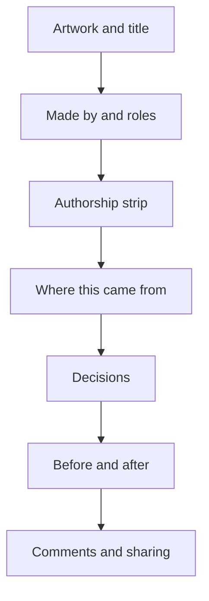

# Designer story specification (PROPOSAL, not accepted scope)

Status: draft for owner review, October 22, 2026. Lineage: leaf #30, parent #29, then #12 and #1. Related issues: #35 (lineage and credits on posts), #36 (comments), #43 (sharing), #50 (authorship record).

Labels: **observed** = read in the repository on `claude/investor-pdf`; **inference** = not tested; **proposal** = does not exist unless named as existing.

Related: [people-and-journeys.md](people-and-journeys.md), [collaboration-and-credit-spec.md](collaboration-and-credit-spec.md), [cultural-context-and-respect-rules.md](cultural-context-and-respect-rules.md).

## The problem and consequence

A designer who publishes today gets a page with the artwork, a one-line description, their name and a list of credits (observed in `PublishedPage`, `src/creative/Editor.tsx`). The reasons they kept each reference, the decisions they made, the directions they declined and the places AI helped are all stored or storable, but none of it reaches the page. A viewer sees a result without a reason, and the designer cannot show that the work is theirs. This specification says which stored records make a story and which controls decide what a viewer sees.

## What a story is made of

A story is not written separately. It is a view over records the project already keeps, plus one new record (authorship, issue #50). Anything on the page that is not backed by a record is not shown, except text the designer wrote for the page and which is labelled as theirs.

| Part of the story | Stored record | Exists today? |
|---|---|---|
| **Goal** | `Project.brief` (the Create idea) | Observed. The brief is stored but not shown in Studio and not published |
| **Kept references** with creator and reason | `Project.references[]`: `title`, `creator`, `source`, `reason` | Observed. Only title, creator and source reach the published page; the reason stays private |
| **Archived references** | `Project.referenceArchive[]` | Observed. Kept for earlier decisions and credits |
| **Decisions** | `Project.decisions[]`: `title`, `reason`, `cites`, `version` | Observed in `server/creative/service.ts`: a decision is written only when a proposal is approved (title is the proposal's intent, reason is the proposal's own rationale, not the designer's words). Declining sets `status: "declined"` and writes no decision |
| **Declined directions** | `Project.proposals[]` with `status: "declined"`, plus its `rationale`, `cites` and `provenance` | Observed: the proposal and its AI-written rationale are kept, but the designer's reason for declining is not stored (proposal: add an optional reason field on decline). Whether declined text is ever public is an owner decision |
| **Versions** | `Project.versions[]`: number, `art`, `motion`, `note`, time | Observed. Immutable snapshots; undo, redo and restore keep them |
| **History** | `Project.history[]`: summary, time, `actor` | Observed, but `actor` is the person's name only |
| **Authorship record** | New event records per layer, decision and version (issue #50) | Proposal. See below |
| **Credits** | `Publication.credits[]`: title, creator, source | Observed. Built from references at publish time |
| **Comments** | `Project.comments[]` | Observed. Private to the board today |

### Authorship record (proposal, issue #50)

Each event records: **origin** (hand, AI-assisted or AI-generated), **tool or model** (for example "Copilot (prototype guidance)", "Claude through MCP", "Hermes", or "by hand"), **step** it served (reference, proposal, layer edit, motion, import), **outcome** (accepted, edited, declined) and time. Versions and decisions point at events. It must store small text records, not file copies (see the storage notes in [people-first-plan.md](people-first-plan.md) section 2).

**Rules that cannot be broken:**

1. **AI work can never be recorded as hand work.** If any part of a change came from an AI proposal, the origin is at least AI-assisted. Only a change the designer made through their own manual control, with no AI proposal behind it, is "hand".
2. **The designer is never shown as having used AI where they did not.** The record cannot be altered to add AI; the designer can annotate an entry and can correct a mislabel only by an appended correction that stays visible in the record (append-only).
3. **Imports, MCP agents and outside tools record the actor and the tool on each call.** An unknown tool is recorded as "unknown AI tool", not as hand.
4. **Any share of hand against AI work is computed from a written formula** (for example counted layers and edits) and labelled an estimate. No percentage appears without its formula one tap away. The formula is the open deliverable of issue #50.
5. **Sample makers show fictional authorship records labelled as sample.**

## Disclosure controls (proposal)

The designer decides what a viewer sees. Observed today: the preview page has one description field and one audience choice, and says "Your board, comments, prompts and saved reasons stay private."

| Control | Options | Default |
|---|---|---|
| Audience | Anyone with the private link, or the Kresilo prototype community (both observed) | Private link |
| Goal | Show or hide | Show |
| Each reference | Show, show without the reason, or hide | Show with the creator named. See rules below for credit |
| Each reason | Show or hide per reference | Hide until the designer chooses |
| Each decision | Show or hide | Hide until the designer chooses |
| Declined directions | Show none, show the decision only, or show the reason too | Show none (owner decision 5 in the people-first plan) |
| Versions | Choose a before and an after, and an optional timeline | None chosen; the designer must pick |
| Authorship strip | Always shown in some form (see below) | Shown |
| Comments | Open to viewers, collaborators only, or closed | Closed |

**Credit is not optional.** A reference whose source work is by another person keeps its creator credit whatever the reason setting, because the preview already states "Make it yours. Keep the credits." and because removing credit would undo the purpose of the record. A designer can hide the reason but not the creator's name for any reference that is still part of the published work. Open owner decision: whether a designer may hide a reference entirely when it did not change the final result.

**The authorship strip cannot be turned off.** The designer may choose how much detail it shows (summary or full), but a published story always shows at least the summary. Reason: if the strip could be hidden, its absence would make every other story look suspect or would let AI work pass as hand work. Open owner decision.

## Layout of the published page `/p/:id`

Today (observed): artwork on one side; on the other an eyebrow ("Private link preview" or "Community project"), title, description, "By {creator}", a list of credits ("With a reference from {creator} · {title}"), Copy link and Back to Explore.

Proposal, in reading order. The same page serves desktop and phone; on narrow screens the share rail moves below the title.

1. **Artwork, title, and the designer's short description.** The goal appears as one line under the title.
2. **Made by.** The owner and any confirmed collaborators with roles (Lead, Design, Type, Motion, Feedback), per [collaboration-and-credit-spec.md](collaboration-and-credit-spec.md). Follow is shown only for real accounts.
3. **Authorship strip.** One row per step: the designer's decision on top, AI proposals beneath, each step labelled Hand, AI-assisted or AI-generated with the tool named. An estimate of hand against AI work appears only with its formula link.
4. **Where this came from.** Each kept reference: small image, title, creator, the designer's reason if disclosed, and a link to the source work. Imported media is credited as set out in the collaboration spec.
5. **Decisions.** The chosen decisions with rationale; declined directions only if disclosed.
6. **Before and after.** Two chosen versions side by side; an optional timeline.
7. **Comments and sharing.** Share rail (link, preview image, embed; issue #43), Keep as a reference, comments if open.

The page also shows an eyebrow of its audience (observed, keep) and a **Sample practice** badge on any sample maker's story.

## Layout of the maker story `/stories/:id`

Observed: `/stories/:id` is a full-screen process story with a progress bar and three slides for the sample maker Ayo Bello ("Behind the Reference" and others), reached from the maker page. It is sample content, not generated from a project.

Proposal: a maker's story is built from the same story view above, one slide per part, so a real person's story and a sample story are made the same way:

1. Cover: the person and their art (cutout portrait over the maker's own design is priority P5).
2. Goal.
3. A reference and the reason.
4. A decision, including a declined direction if disclosed.
5. Before and after.
6. Authorship strip.
7. Credits and the sources.

Open owner decision (people-first plan 4): is a story a permanent process story, a short daily layer, or both. This specification covers the permanent process story only.

## What stays private

Regardless of settings, the following are never published by this prototype (observed in the preview text and `docs/user-flows.md` unless marked):

- The project board, comments, prompts and saved reasons the designer did not choose to disclose.
- Imported private media: "private imported canvas images cannot be published by this prototype" (observed publication guard).
- Taste profile and the stored declined-direction history (proposal; also see #51: the artist can see, edit and erase it).
- The invitation token and anyone else's account details.
- Credentials, connection strings and keys. These stay on the server and out of the repository and the client.
- A private project never appears in "Used in" on another work.

## Acceptance for this specification

Matches the shared test in [people-and-journeys.md](people-and-journeys.md). In addition:

1. Each element on `/p/:id` links to its record; a test removes a record and the element disappears.
2. An AI proposal that the designer approved is never labelled Hand (a test with an approved proposal).
3. The authorship strip is present on every published page, including sample stories.
4. A private project and a hidden reason never appear in the page source (not just hidden by styling).

## Open owner decisions

1. May declined directions and prompts ever be public (people-first plan, decision 5)?
2. Can a designer hide a reference's creator, or hide a reference entirely?
3. Can the authorship strip be hidden or reduced to nothing?
4. Stories: permanent process stories, a daily layer, or both?
5. Is the published page's `description` the only free text, or does a story also get a short "what I'd tell someone" note?

## Could not be grounded

- A designer's own reason for declining, and for approving: only the AI's rationale is stored today (observed in `server/creative/service.ts`), so "decisions including declined ones" needs a small new field before the story can show the designer's reasoning rather than the Copilot's.
- The authorship record schema and formula do not exist; they are the next action on #50.
- No visual design exists for the new page layout; the sample screens in the people-first plan are proposals on a private canvas.
