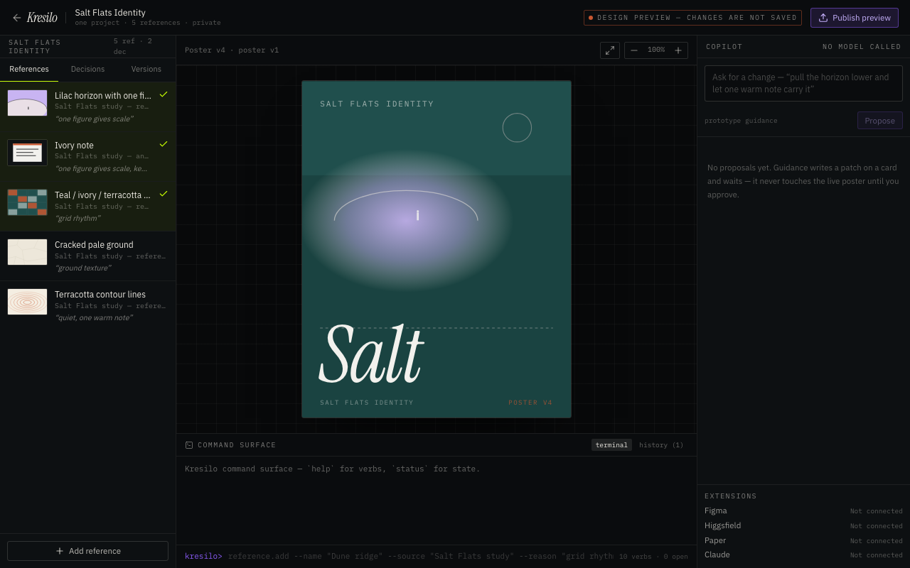
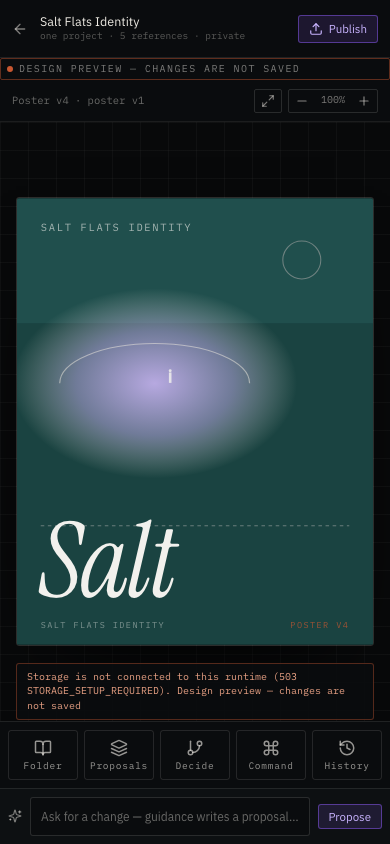

# The first Kresilo app renders but needs correction

The first generated homepage and Studio serve successfully from a production build on the MacBook Pro. They are imported for review, with no product acceptance claim. The source comes from the preserved ABA workspace at builder commit `c13b363ccefaef63cb217055814ad710b31a8970`, run `kresilo-repair-20261017`, completed October 17, 2026. The original repository governance and verified applied migration are preserved; the builder’s newly added, unverified purge routine was not imported or applied.

The builder reported `gatesPassed: true` after reaching its 100-step limit. Independent checks contradict application readiness:

| Check | Observed result |
| --- | --- |
| Production build | Vite and Nitro output generated successfully |
| TypeScript `tsc -b` | Failed with 13 errors in result narrowing, missing imports and a nonexistent project field |
| ESLint | Failed with 11 errors and 9 warnings |
| Required scripts | `typecheck` and `test` are absent; no application tests exist yet |
| Production HTTP | `/` and `/demo` return 200; missing storage credential returns 503 without paths or SQL in the response |
| Initial responsive smoke | Both routes opened at 1440,1280,768,390,375,360 and430px with no page exceptions or document-level horizontal overflow |

The responsive smoke checks only initial rendering. They do not prove touch behavior, modal focus, form submissions, fidelity, refresh durability, or the completed journey. [The result record](qa/first-render/responsive-results.json) preserves that boundary.

## Visual findings

The original desktop design uses a small poster and proposed variant beside source tiles on a dotted board. The first app instead centers one oversized poster on a line grid. Its Salt Flats horizon is a blurred ellipse; the source uses a crisp lilac/cream circle. Homepage copy exposes command syntax and implementation details. Mobile renders but needs the source poster proportions and toolbar treatment.

| First desktop Studio | First mobile Studio |
| --- | --- |
|  |  |

The [desktop homepage](qa/first-render/kresilo-home-first-desktop.png) and [mobile homepage](qa/first-render/kresilo-home-first-mobile.png) are also captured. These are actual initial app renders, not reference images substituted for UI.

## Connection and behavior findings

Code review found an invented REST endpoint and named SQL bindings that differ from Kristello’s verified positional-parameter contract. Store mapping does not consistently unwrap the applied SQL functions’ nested snapshots. History uses the wrong response property and manual decisions use the wrong parameter type. The browser automatically enters unsaved preview after storage errors; it must ask the viewer to choose preview explicitly. Proposal fallback can omit actual citations. Session expiry and bundled artwork mapping also need verification.

The exact corrective input is [the visual and connection review request](builder-visual-review.md). Run `kresilo-visual-review-20261017` continues the same builder workspace and chat, with original assets and domain modules preserved. It requires meaningful adapter and command tests, corrected lint/type scripts and a successful production build before acceptance.

The app server credential remains unavailable. Attached Kristello MCP access works and [26 direct database checks passed](database-verification.md), but the existing Drive account key returned 401 and the shared builder key is restricted to another workspace. No unrelated key or alternate database is installed. Hosting at the owner-approved hostname waits for the completed browser acceptance checks.

Leaf #2, parent #1; setup dependency #9 delivered through PR #10. Task KRES-0002, primary writer Codex, branch `codex/kresilo-prototype`, draft PR #11. Next: inspect the corrected builder output, run application checks and repeat visual and functional browser testing. Issues #3–#8 remain open.
