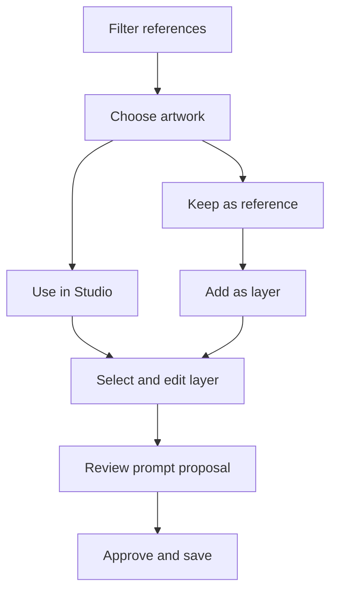

# References become editable canvas assets

## Hosted project-flow correction

The corrected flow is live from accepted source db5e442 through PR #26. Required MacBook Pro push and merge-candidate checks pass with 85 tests. Seventeen preflight project-flow assertions pass before the existing-service switch; HTTPS checks pass seventeen project/reference, eighteen history and twenty-one layered/model assertions. The public JavaScript hash matches the host build. Mobile browser checks verify named creation, a drawer that stays open for asset choice, a saved layer with matching prompt target, required-reason/destination copy, focus return and refreshed artwork. [Hosted evidence](qa/project-flows/hosted-project-flow-acceptance.json) and [flow maps](user-flows.md) record behavior and limits.

Leaf #20; parent #12 then #1; dependencies accepted #14/#15/#18 and setup #8. Task KRES-0010; writer Codex; evidence branch `codex/project-flow-release-evidence`. [Hosted scope receipt](https://github.com/Pukujan/kresilo/issues/20#issuecomment-6348590303). Runtime configuration bytes are unchanged, the previous release/rollback remain, and preflight is stopped. This evidence increment's checks and merge remain pending; source and hosting acceptance are already observed. Next: verify report-only acceptance without another service mutation.

## Clear project and reference destinations

The owner found that opening, saving inspiration and replacing artwork looked like the same action. The current follow-up makes creation, board collection and canvas changes explicit. [The flow maps](user-flows.md) connect each route to its typed command and explain guest recovery, copying/removing references, selected-layer prompting and sharing.

Leaf #20; parent #12 then #1; dependencies accepted #14/#15/#18 and setup #8. Task KRES-0010; writer Codex; branch `codex/clear-project-flows`. [Owner correction](https://github.com/Pukujan/kresilo/issues/20#issuecomment-6348041117). This entry records local implementation only; required MacBook Pro checks, merge and follow-up hosting remain pending.

The UI names projects before creation, identifies the destination and operation, defaults existing-project use to a separate image layer, and requires explicit background replacement. References and Current artwork have separate board sections. Rename, copy, reversible removal and restoration go through the existing typed service with revision checks. Removal retains provenance for earlier decisions; private imported metadata is excluded from public credits. Copy and remove remain two explicit steps; imported media stays project-scoped.

Mobile asset selection stays open until a real layer saves. No-layer mode disables prompting; target labels agree. Project navigation clears old editor state, and late responses from a former session are rejected before state updates or navigation. Same-session project responses retain the newest revision. Profile choices serialize their saves, and unsaved profile text survives unrelated workspace responses. Keyboard focus returns to modal launchers; selected assistance text has a dark-mode background with readable contrast. Guest limits appear before new-project saves.

Local evidence includes seventeen isolated runtime checks for project/reference correction, conflict, refresh and history, plus twenty-one layered/model assertions with a real provider response. Browser checks cover creation, reference-only saving, rename, reversible removal, searchable picking, 320-pixel project identity, mobile asset selection and matching prompt targets. The focused tests also cover delayed replies and private archived filenames. [Acceptance evidence](qa/project-flows/project-flow-acceptance.json) distinguishes observed local results from pending delivery. No migration, research write, new database or configuration change is introduced. Native phone hardware and Google sign-in remain unverified. Next: pass final repository and required remote checks before the hosted switch.

A visitor can now open a catalog work in Studio, use a saved reference as the background, or add it as a separate image layer. The local review exposed two distinct failures: the server had no storage credential, and the interface hid the distinction between keeping inspiration and editing artwork.

Leaf [#20](https://github.com/Pukujan/kresilo/issues/20) owns this increment; parent #12 → #1; dependencies are accepted reference and media work #14/#15. Task KRES-0010; primary writer Codex; branch `codex/reference-studio-layers`. The [owner-scope correction](https://github.com/Pukujan/kresilo/issues/20#issuecomment-6335621663) expands the earlier one-background prototype. The earlier implementation was accepted through PR #21 at 47d22a4. The mobile follow-up described below passes local checks; its remote gates and merge remain pending. Hosted release is separate.

## Using the workspace

1. Search discovery by title, creator or tag; combine creator, discipline, still/motion and existing place filters.
2. Open a work. Use in Studio starts a new project with that image, or replaces an existing background. Keep as a reference saves to the board without changing artwork. A reason preserves the connection to the source.
3. On a reference board, Use as background and Add as layer open Studio directly. Uploaded image references support both actions. Videos remain references, rather than draggable image layers.
4. Select an image from the sidebar or canvas. Drag it to move it; drag the title to reposition its text. Double-click the title or choose Text to edit the words. Image controls change position, width, height, rotation, opacity, visibility and none/grayscale/warm/cool filters. Bring forward and Send backward reorder images; desktop sidebar rows also support drag reordering. The title and caption stay above image layers. The prototype allows twelve image layers.
5. On mobile, the Layers toolbar icon opens a focus-managed bottom drawer. Choose the layer there, adjust it, or return to the canvas and prompt it. Mouse-based responsive tests do not establish native iOS touch behavior.
6. A prompt targets the selected layer. Preview and approval remain separate actions. Accepted changes record a version and decision; a refresh reloads the saved artwork. Example prompts: “make it smaller and move left”, “rotate 15 degrees”, “opacity 50%”, or “use a cool filter”.

Dark mode follows the device initially and remembers a manual selection in this browser. It changes interface surfaces, not artwork colours.

## Faster original motion

The owner requested the pace of [Lina Guerrero's Spring Show campaign](https://www.linamakesnoise.com/2025springshow) as creative direction. Three additional original four-second loops are available in the Motion filter: Chrome orbit uses Orbit cuts, Red interval uses Type rush, and Night signal uses Signal shuffle. The gallery now has six playable motion references within sixteen total works. No campaign footage or proprietary fonts were imported.

Motion exposes Relaxed, Brisk and Fast pace. Fast cuts change every quarter second; fast kinetic type pulses every half second. Preview CSS and MP4 export use the same saved beat. Starting a new project from a motion work carries its preset into Studio. Existing slow drift, rise, still, pause and reduced-motion behavior remain available.

The original new motion files were rendered through the app's trusted HyperFrames pipeline. On this Windows host its automatic browser download stalled, so local ignored configuration now points at the installed Chrome through the renderer's supported environment option. No global browser or service setting was changed.

## Sources and boundaries

The collection contains six explicitly fictional makers and sixteen works. The six new references are original SVG studies: Tidal lines, Chrome orbit, Red interval, Night signal, Garden grid and Paper orbit. Ren, Leila and Inês use original graphic monograms. These additions do not copy third-party artwork or assert real creator identities.

All writes still use the same typed command service and existing Octo `kresilo_demo` runtime. No migrations or research writes were needed. Existing local credentials are held in ignored server configuration. Neither secret values nor guest cookies belong in this report or repository.

The configured model proposes structured changes only. Its response cannot introduce executable compositions or change a different layer. A labelled preset fallback handles bounded transforms; unsupported requests fail with guidance. Pixel-level image retouching, background removal, arbitrary new image generation and video-layer compositing are not implemented. SVG references reach the model as textual source context; supported raster/video references can also supply media.

Imported canvas images remain private and are blocked from prototype publication; catalog-only layered artwork can use the existing sharing flow. This is an explicit limit, not a claim that private uploads are publicly shareable.

## Local evidence

The [API acceptance record](qa/layered-workspace/api-acceptance.json) verifies actual saved creation, independent layers and credits, live-model targeting, inert proposals, approval, idempotence, fresh reads, conflict rejection, layered restore, filters/visibility/order, private imports and guest isolation. The model returned a valid layer proposal and reported its cost. Unit tests cover immutable nested snapshots, invalid sources and filters, duplicate IDs, unsupported prompts and focused fallback behavior.

Browser verification exercised reference start → Studio, actual pointer dragging with persisted coordinates, a live rotation/filter proposal → approval → reload, combined discovery filters and empty states, dark-mode persistence, and the mobile layer drawer at 390 × 844 without horizontal overflow. [Desktop canvas](qa/layered-workspace/desktop-canvas-dark.png), [mobile canvas](qa/layered-workspace/mobile-canvas-dark.png), [mobile drawer](qa/layered-workspace/mobile-layers-dark.png), and [filtered discovery](qa/layered-workspace/discovery-filters-dark.png) preserve the observed views.

Application lint, types, 67 unit/contract tests and production build pass locally. Existing lint warnings remain. The pinned repository verifier also passed locally with a process-local Windows command adapter resolving pnpm.cmd; the final verifier passes at the product revision recorded in [repository verification](qa/layered-workspace/repository-verification.json). Required remote MacBook Pro checks remain pending. Local results do not establish a hosted release.

The final [API run](qa/layered-workspace/api-acceptance.json) passes 25 checks, including an actual two-second fast layered MP4 export with a private imported background. A previous run during local configuration changes failed at proposal creation; its cause was not established, and the fresh run passed with a real model response. The [fast-loop record](qa/layered-workspace/fast-motion-acceptance.json) verifies H.264, 540 × 720, four seconds and three distinct decoded frames for each new loop. Decoded images were visually inspected. The [browser playback record](qa/layered-workspace/browser-playback.json) shows all six gallery videos playing with no media error. Native mobile playback and touch hardware remain untested.

Evidence filenames describe the surface and theme: desktop/mobile canvas, mobile layers drawer and discovery filters. Motion frame files identify the original sample and frame number; the JSON record gives its sampling time and hash. Sample media names describe the motion: Orbit cuts, Type rush and Signal shuffle.

## Mobile review on October 22

The owner found the floating theme button covering Send and requested nearby compact controls and an upward Layers drawer. [The mobile correction](https://github.com/Pukujan/kresilo/issues/20#issuecomment-6336826699) owns this follow-up within the same leaf #20, parent #12 then #1, dependencies accepted #14/#15/#18. Writer Codex; branch `codex/mobile-studio-controls`; task KRES-0010. The earlier source increment was accepted through PR #21, squash merge 47d22a4; the follow-up is locally verified with remote gates and merge pending as of this entry. Hosting remains the earlier release.

Mobile Layers and theme icons now sit beside Text, Colour, Motion and More above the prompt. The drawer rises from the bottom, lists layer icons and names, and collapses on selection, outside tap, Escape or Close. Keyboard focus returns to Layers. Reopening retains the selected layer and its precise controls. The prompt displays its target separately from the example text and explains review and approval.

Browser checks at 360, 390 and 430 pixels show no horizontal overflow and an unobstructed 44-pixel Send target. A fresh mobile model call returned a 20-degree rotation and cool filter for Tidal lines. The canvas was unchanged before approval; approval and a fresh reload preserved the change, while Garden grid stayed unchanged. The provider identified ali/qwen3.8-omni-flash and reported $0.000010. Theme controls switch both ways. Desktop retains its sidebar. These are responsive browser observations, not native phone hardware tests.

The follow-up evidence files are [mobile controls](qa/layered-workspace/mobile-studio-controls.png), [upward drawer](qa/layered-workspace/mobile-layer-drawer.png), and [prompt acceptance](qa/layered-workspace/mobile-prompt-acceptance.json). Their names mean the toolbar, layer sheet and observed proposal checks respectively; the machine legend is `.content-system/filename-legends/mobile-studio-controls.json`.

The follow-up pinned repository verifier exits successfully: lint has zero errors and the same thirteen existing warnings; types, all 67 tests and the production build pass. The verifier used the same process-local Windows command adapter as the earlier run. Required MacBook Pro checks remain pending at this documentation revision.

The first remote run rejected the new filename legend because it used `paths` instead of the required `files` records. The local full verifier had run before that legend was added, so its success did not cover the final manifest. The correction adds the required records and helper identities; the content validator now passes with the final legend. Application source is unchanged from the locally passing build. Failed runs remain visible: push 39752578051 and pull-request 39752623033. Fresh final-head MacBook Pro checks are pending.

## Undo, Redo and Versions

The owner requested direct history controls in the mobile Studio. [The history scope correction](https://github.com/Pukujan/kresilo/issues/20#issuecomment-6337085970) supplements the accepted mobile increment from PR #22 at dac6b03. Leaf #20; parent #12 then #1; dependencies accepted #14/#15/#18. Task KRES-0010; writer Codex; branch `codex/studio-undo-versions`. This follow-up is locally verified; required MacBook Pro gates, merge and any hosted rollout remain pending as of this entry.

Undo, Redo and Versions sit below the editing tools on desktop and mobile. Unavailable actions are disabled. Undo and redo restore saved artwork and motion together, including accepted prompt edits, while keeping immutable snapshots. They persist through refresh. New artwork edits, approved proposals, motion changes or an explicit version restore clear redo. Reference and comment events do not add artwork undo steps. Older projects derive their initial undo trail from existing versions. No database migration is needed: navigation stacks are server-owned fields in the existing project document, written through the shared typed command service with revision checks.

Versions opens the saved snapshot list directly. Its preview says Current or Saved snapshot, and restoration remains an explicit action; closing returns focus to Versions. Dark selected rows remain readable. Undoing a restore brings back the prior artwork. All later versions remain available. Ctrl/Command Z undoes and Ctrl/Command Shift Z redoes; Ctrl Y also redoes. Shortcuts ignore text fields, editable content and open dialogs. Existing prototype history limits still apply; undo and redo each append an audit version.

The pinned local repository verifier passes lint, types, all 71 tests and the production build. Four new unit tests cover multi-step navigation, nested snapshot isolation, legacy compatibility, restored versions, branching and command revisions. The isolated live script passes 18 storage checks, including conflicts, refresh, comments, branch retention, explicit restore and guest isolation. Mobile browser checks confirm button undo/redo of the last approved prompt edit, refresh persistence, keyboard shortcuts, version preview and focus return. At 360 and 430 pixels the controls have 44-pixel heights and no horizontal overflow. Native phone hardware is untested.

Evidence: [mobile version controls](qa/layered-workspace/mobile-version-controls.png), [saved-version preview](qa/layered-workspace/mobile-saved-versions.png), and [acceptance record](qa/layered-workspace/version-controls-acceptance.json). Their names describe the toolbar, snapshot preview and observed tests; the mobile Studio filename legend records the helper identities. Reproduce live checks with `node scripts/verify-version-controls.mjs` against the configured local runtime. It creates isolated QA guest data in the existing workspace.

## Profile access, spelling and live release

The owner requested easier own-profile access and deployment of the latest tested features, then identified misspelled lettering in the main logo. Scope sources: [profile and deployment correction](https://github.com/Pukujan/kresilo/issues/20#issuecomment-6346918866) and [wordmark correction](https://github.com/Pukujan/kresilo/issues/20#issuecomment-6347025421). Leaf #20; parent #12 then #1; dependencies accepted #14/#15/#18 and deployment setup #8. Task KRES-0010; writer Codex; branch `codex/profile-live-release`. Prior layered/mobile/history source acceptance is PRs #21–#23, most recently merge 2abe76d. This entry is an as-of readiness record; hosted deployment is pending.

The main header now has a visible Profile shortcut, including on mobile. Project and reference headers offer a direct own-profile icon; the mobile navigation says Profile rather than You. These open the existing private profile at `/you`, distinct from sample creator profiles. The page labels its destination Your profile. The wordmark is now exact text, Kresilo, in the existing licensed Instrument Serif italic face, replacing ambiguous generated raster lettering. Dark-mode profile navigation remains readable. At 320 pixels the Studio header is tightened so the profile control stays fully visible.

Local browser checks verify navigation from the homepage, a reference page and fully loaded Studio to the current guest profile; the exact visible wordmark is Kresilo. Mobile checks at 320/360 pixels show no overflow and a 44-pixel profile control. Existing local application checks pass lint, types, 71 tests and production build; final required MacBook Pro checks must validate the combined source before release.

The owner authorizes the existing `https://kresilo.design-bakery.com` hostname. Deployment will build the accepted source in a separate release directory on the existing MacBook Pro, preserve the old release and service configuration, preflight the new artifact on a loopback port, then update the existing launchd service on its existing port. Credentials stay server-only; no research writes, database migration or tunnel changes are required. The hosted release will include the accepted layers, assets, filters, dark mode, mobile drawer, focused prompts, Undo/Redo and Versions. Verify fresh HTTPS navigation and persisted commands before claiming delivery; live issue receipts own the subsequent release facts.

## Hosted acceptance on October 22

The accepted source e106f4f from PR #24 is now running on the existing hostname. The public entry asset matches the host build SHA-256; the existing service port and tunnel routes remain unchanged. The previous release and rollback configuration are retained, and preflight is stopped. The first launchd bootstrap attempt failed; the old service was recovered and a subsequent normal reload switched successfully. Interruption duration was not measured.

Through HTTPS, 25 layered/model/export checks and 18 history checks pass. The model made a valid focused proposal; approval, refresh and guest isolation pass. The exported layered MP4 is verified H.264, 540 × 720, two seconds. Browser checks verify exact Kresilo lettering, visible own-profile access, reference → Studio, the mobile drawer and Studio → own profile. Studio at 320 pixels and profile at 390 pixels have no horizontal overflow. [Host identity evidence](qa/layered-workspace/hosted-release-acceptance.json) and the updated [delivery report](../DELIVERY_REPORT.md) distinguish observed deployment from the API script's standalone limits.

Leaf #20; parent #12 then #1; dependencies accepted #14/#15/#18 and setup #8. Task KRES-0010; writer Codex; evidence branch `codex/hosted-release-evidence`. [Live-scope receipt](https://github.com/Pukujan/kresilo/issues/20#issuecomment-6347251516). This evidence increment's own required CI and merge remain pending. Native phone hardware and Google sign-in remain unverified; private imported canvas images remain blocked from publication.
