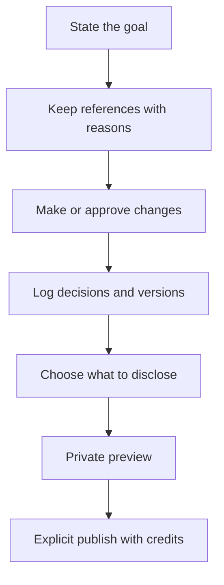

# People and journeys: who Kresilo is for (PROPOSAL, not accepted scope)

Status: draft for owner review, October 22, 2026. Nothing here is accepted scope until the owning GitHub issue is confirmed. Lineage: leaf #30, parent #29, then #12 and #1. Dependencies: none.

Labels: **observed** = read in the repository on `claude/investor-pdf` (`src/App.tsx`, `src/creative/contracts.ts`, `docs/user-flows.md`); **inference** = my reading, not tested; **proposal** = does not exist unless named as existing. Source plan: [people-first-plan.md](people-first-plan.md).

Related documents: [designer-story-spec.md](designer-story-spec.md), [collaboration-and-credit-spec.md](collaboration-and-credit-spec.md), [cultural-context-and-respect-rules.md](cultural-context-and-respect-rules.md), [user-flows.md](user-flows.md).

## The problem and why it matters

Kresilo can keep a reference, ask the Copilot for a proposal, and save a version, but nothing written down says who the product serves or what a finished, published piece must let a stranger understand. Without that, each build decision is judged against taste, and a designer cannot tell whether the product helps them explain their own work. The consequence is a polished demo that records activity but does not tell a story.

The outcome this document protects (proposal, from the people-first plan): **a person can show where their work came from, what they decided, who they owe, and exactly where AI did and did not help.**

## The people

Each person below is a role someone plays, not a separate kind of account. One real person can be several of these on the same day.

| Person | What they want | Where they appear today (observed) | What is missing (observed or inference) |
|---|---|---|---|
| **Designer or artist** (Studio author) | Turn kept references and their own reasons into work they can explain, with AI under their control | Create `/create`, Studio `/studio/:id`, Projects `/projects`, board `/projects/:id`, preview `/preview/:id`, own profile `/me`, settings `/you` | No published story; history stores one `actor` string, so a hand edit and an approved AI change look the same |
| **Maker whose work is referenced** | Credit, consent, and seeing their influence travel | Sample makers at `/people/:id` with process at `/stories/:id`; all sample makers are fictional (observed in `src/creative/catalog.ts`) | No real maker can be asked for consent or notified; no "Used in" on a source work; no consent policy yet |
| **Collaborator** (invited) | Give feedback or edit, and be credited with a clear role | Invitation `/join/:token` grants edit and comment access for seven days (observed in `docs/user-flows.md`) | No role, no credit confirmation, comments only on the board |
| **Visitor** | Find work and understand why it looks the way it does | Explore `/`, work `/work/:id`, published page `/p/:id` | The published page shows art, a description, the creator and a credit list; it does not show reasons, decisions or authorship |
| **Follower** | Keep track of makers they like | `following` is a field on the person record (observed in `contracts.ts`) | No visible follower feed or notification |
| **Guest** | Try Kresilo without committing | Guest identity is isolated per browser; the lifetime limit is shown before creation (observed in `docs/user-flows.md`) | No recovery across devices until Google sign-in is configured (blocked, issue #13) |
| **Curator** | Keep the library honest and good | Not present in the product | Proposal: a role that reviews sample works against the quality gate and the respect rules; owner decision whether this is a person or a checklist |
| **Reviewer of AI help** | Judge whether the Copilot helped, and where | Proposals are stored with `rationale`, `cites` and `provenance` (observed in `contracts.ts`) | No way to see approved against declined proposals over time or the anti-slop screen from issue #51 |

## The three journeys

All three run from a goal to a published story. They differ in how much the product guides and how many tools are visible. The code names the levels `guided`, `explorer` and `advanced`; the owner's words are beginner, casual and expert. Observed: the level is stored on `/you` but Studio does not yet change its layout by level.

1. State the goal (the Create idea). 2. Keep references with reasons. 3. Make or approve changes. 4. Decisions and versions are logged. 5. The designer chooses what to disclose. 6. Private preview. 7. Explicit publish with credits.

### Beginner

Someone new to design tools, working on a phone or laptop, who wants a result and a way to say why.

| Step | What the person does | Route or command (observed unless marked) |
|---|---|---|
| Goal | Writes one sentence | `/create`, `project.create` |
| References | Keeps one to three references and writes why for each | `/work/:id`, `reference.carry` |
| Proposal | The Copilot proposes, citing those references | `proposal.request` (observed); the prompt box explains the missing step before submit (proposal, priority P12) |
| Decide | Approves, edits or declines | `proposal.accept`, `proposal.reject` |
| Tell the story | Answers guided prompts: why this, what changed, who helped (proposal) | New story step before preview |
| Preview and publish | Private preview, then an explicit publish | `/preview/:id`, `publication.create`, `/p/:id` |

**Acceptance test, beginner:** a first-time user, unaided, goes from Create to a published story in under fifteen minutes, and the published page passes the shared test below. Inference: untested; needs five first-time users.

### Casual

Someone who edits regularly and wants control without a long tool list.

| Step | What the person does | Route or command |
|---|---|---|
| Goal and references | As beginner, with a short audience note (proposal) | `/create`, `/work/:id` |
| Hands-on canvas | Layers, size, filters and simple motion from a reduced toolset | `/studio/:id`, `/motion/:id`; tool list in [studio-tools-plan.md](studio-tools-plan.md) (proposal) |
| Decisions | Decisions come from saved versions; the person picks which appear | `version.*` commands; decision selection is proposal |
| Publish | Chooses disclosure, previews, publishes with credits | `/preview/:id`, `/p/:id` |

**Acceptance test, casual:** the person picked which decisions and versions appear, and the published page shows at least one before and after version taken from stored versions.

### Expert

Someone who wants every tool and a precise record, for example to show a client or a studio how a piece evolved.

| Step | What the person does | Route or command |
|---|---|---|
| Goal and audience | Writes both | `/create` plus an audience field (proposal) |
| Reference board with lineage | Keeps references, sees what each led to | `/projects/:id`; lineage across projects is proposal (#39) |
| Full canvas and console | All tools, the command console and adapters (Open Design is unverified, see [open-design-spike.md](open-design-spike.md)) | `/studio/:id` |
| Decisions including declined directions | Records declined proposals and why | `proposal.reject`; publishing declined ones is an owner decision |
| Curated timeline | Chooses a process timeline from versions and decisions | Proposal |
| Publish with lineage and credits | Full disclosure options | `/preview/:id`, `/p/:id` |

**Acceptance test, expert:** the published story includes at least one declined direction with its reason, if the designer chose to disclose it, and the authorship strip names the tool for every AI step.

## The shared acceptance test: "can a designer tell their story with this?"

A flow passes only when all of the following are true (this restates the people-first plan):

1. The published page shows the goal.
2. It shows at least one credited reference together with the designer's own reason.
3. It shows at least one decision with its rationale.
4. It shows a before and after version.
5. It shows the authorship strip, with AI help named by tool and never recorded as hand work.
6. Every element above traces to a stored record, not to text written only for the page.
7. The designer chose the audience and what to disclose; nothing private appeared by default.
8. A first-time viewer can say why the piece looks the way it does within one minute (inference: test with five viewers who have not seen the project).

What counts as a "stored record" is defined in [designer-story-spec.md](designer-story-spec.md).

## What is out of scope

Full social network, live co-editing, native apps, marketplace features, and any claim of a share of hand against AI work that does not come from the written formula in issue #50. Observed constraint from `AGENTS.md`: the current deliverable is a responsive web prototype with one working workflow; the longer product requirements document informs meaning but does not widen scope.

## Open owner decisions

1. Do the three journeys count as scope beyond the one working workflow (confirm on #12)?
2. Is the curator a person or a written checklist?
3. Which published elements may a designer hide by default, and which are always shown (for example the authorship strip)? See [designer-story-spec.md](designer-story-spec.md).
4. The code level names `guided`, `explorer` and `advanced`: rename to beginner, casual and expert in the interface, or keep both?

## Could not be grounded in the repository

- Real people for any persona: there are none; the only makers are labelled fictional samples.
- There is no separate "product requirements" document in the repository, so no persona was checked against it.
- The Octo research tables `journeys`, `requirements`, `product_truth_map` and `open_questions` were not queried for this draft; compare these personas to them before acceptance.
