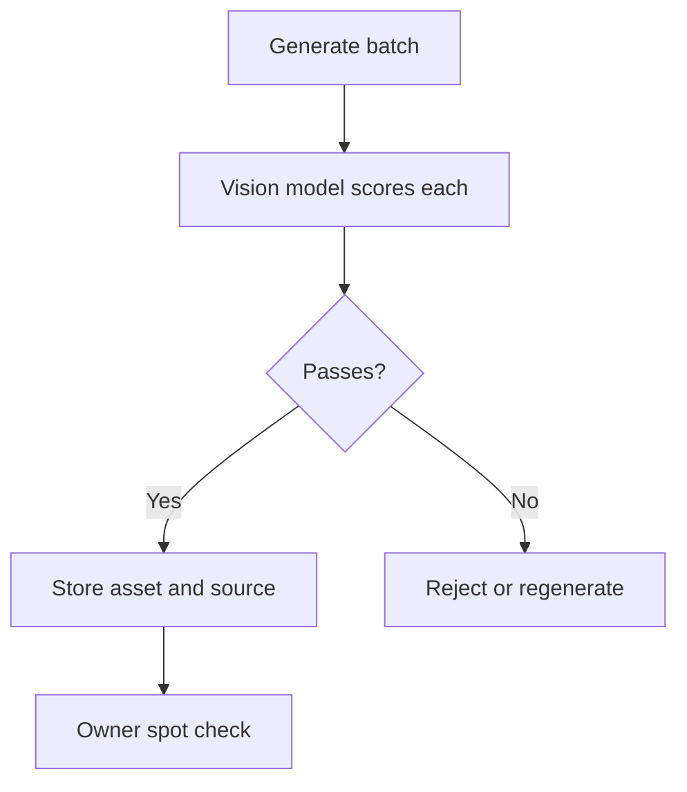

# Product priorities after the partner review (DRAFT, not filed)

Status: draft for owner review on October 22, 2026. Nothing here is accepted scope until the owning GitHub issue is filed and confirmed.

Lineage: proposed new leaf issue; parent #12, then #1. Dependencies: #13 (accounts, blocked on Google credentials), #20 (reference-to-Studio work, accepted through PR #26). Task ID assigned when the issue is filed.

## The problem in plain words

Kresilo looks good but still feels like a demo. A visitor cannot tell who the people are, cannot see their own profile, cannot sign in, and cannot trust that a reference they keep has a history. The business partner and the owner reviewed the live site and produced a priority list. This document records that list, what already exists, and what is missing, so the plan survives outside chat.

## Method and labels

- **Observed** means someone looked at the live site at https://kresilo.design-bakery.com on October 22, 2026, or ran a read-only query against the existing Octo workspace.
- **Repository** means read from `origin/main` at b83f3e1, which includes pull requests #21 to #27.
- **Inference** means a conclusion not yet tested. Each is marked.
- Owner and partner statements are labelled as such. Words like "Open Design" refer to the external project `nexu-io/open-design` (Apache-2.0), inspected from its documentation only, not run.

## Priority list

| # | Priority | Source | Current state | Evidence |
|---|---|---|---|---|
| P1 | "Your profile" opens a settings page instead of a profile | Owner | Missing. `/you` holds name, location, influences, a motion toggle and the three help modes. | Observed; repository `docs/user-flows.md` defines `/you` as preferences |
| P2 | No sign-in, so guests cannot recover work across devices | Owner | Blocked. Google routes and a `google_subject` column exist, but no client ID or secret is configured. Owner chose guests for the presentation. | Repository, issue #13 |
| P3 | De-duplicate user content and keep its history of lineage | Partner | Missing. Only a skip for an already collected reference exists. No chain from a reference to the work made from it. | Repository search |
| P4 | More people, with professional portraits on backgrounds | Partner, owner | Missing. Six sample creators on Explore. | Observed |
| P5 | Maker intro: the person's no-background portrait over their own design | Owner | Missing. Depends on P4 cutouts. | Observed |
| P6 | Canvas layers with size tweaking | Partner | Mostly present. Layers, dragging, reorder and a mobile drawer shipped in #21 and #22. Resize needs a hands-on check. | Repository; layer panel observed |
| P7 | Undo and redo | Partner | Present. Added in #23. | Observed controls |
| P8 | Icons | Partner | Missing. Much of the interface is text and very small controls. | Observed |
| P9 | Like, comment, and bookmark (bookmark means "Keep as a reference") | Partner | Keep exists as text. Comment exists for invited collaborators in the backend. Like not confirmed as a user feature. | Repository search; not tested as a user |
| P10 | More high-quality assets, vision-checked | Owner | Thin: about 16 works and a few vector studies. | Observed |
| P11 | Studio help levels (beginner, casual, expert) | Owner | Partly present: the three modes are stored on `/you`. Studio does not yet change its layout by mode. | Observed; repository `src/creative/Workspace.tsx` |
| P12 | Studio gate gives no inline guidance | Reviewer | A prompt before saving a reference and reason shows only an error toast. The idea typed on Create is not carried into Studio. | Observed |

Explore is deliberately unguided. This was an owner decision and is not a defect.

## What each item needs to count as done

- **P1** A profile page for the current guest or account with name, portrait, projects and kept references, separate from preferences. Settings stay reachable from it. The sample-maker layout at `/people/:id` is the starting point.
- **P2** Real Google sign-in with owner-supplied credentials, then a guest-to-account adoption test. Without credentials this stays blocked and must not be simulated.
- **P3** One stored copy per distinct image per owner, with each use pointing to it. Each reference and project records where it came from, and the Studio shows that chain.
- **P4** At least 12 additional original fictional makers, each with an on-brand portrait on a background.
- **P5** Each maker story opens with the maker's cutout over their own design.
- **P6, P7** Verify resize, reorder, hide, undo and redo on desktop and mobile and record the result.
- **P8** A consistent icon set, with labels kept for accessibility.
- **P9** Bookmark icon for Keep as a reference. Like and comment visible to people who can see the work, with removal and a defined audience.
- **P10** Several times the current library, each asset passing the quality gate below.
- **P11** Studio shows only what the chosen level needs. Expert exposes the command console and full tool options.
- **P12** The prompt box explains the missing step before submit. Create's idea text appears in Studio.

## Proposal (not built): the asset quality gate

None of this exists yet. Generated portraits and assets go through a vision review before they are accepted.

1. Generate a batch with the image model.
2. A vision model scores edge cleanliness, face quality, brand fit and artifacts.
3. Passing assets are stored with their prompt and source. Failing ones are regenerated.
4. The owner spot-checks before anything is published.

The InferHub `qwen3.8-omni-flash` model is the candidate reviewer. It has not been tested for this task. Image generation can use the InferHub image models.

## Direction: Open Design as the design core (owner, October 22, 2026)

The owner has chosen Open Design (`nexu-io/open-design`, Apache-2.0) as the base for how people design in Kresilo: its canvas for UI and UX design, its adapters and its motion tools, ported into the Studio for the three help levels. The owner cites a very large community (over 100,000 GitHub stars); that figure is not verified here. Nothing is built, and Open Design has been read from its documentation only, not run.

| Flow | Proposed use of Open Design |
|---|---|
| Beginner | Guided steps; the Copilot proposes from the person's references and they approve. The canvas shows only what the current step needs. |
| Casual | The canvas with a reduced toolset: layers, size, filters, simple motion from templates. |
| Expert | The full canvas, the command console, all adapters and motion options. |

To verify first: that it runs on the MacBook Pro, which canvas and adapter parts can be reused, how it fits the rule that every project change goes through one typed command service and proposals change nothing before approval, and whether it runs beside Kresilo as a service or is ported in. The existing `creative_motion_jobs` table in the Octo workspace already holds motion jobs. This direction supersedes the earlier "open question" wording; the owning GitHub issue still needs a comment recording it.

## Constraints that do not change

- Work stays in the existing Octo workspace, `kresilo_demo` runtime schema. `kresilo_research` stays read-only. No second database.
- Agent proposals do not change anything before approval.
- Credentials stay server-side and out of the repository.
- The repository stays private. Delivery still needs the MacBook Pro required checks.

## Known unknowns

- Contents of the `creative_*` tables were counted (36 media, 69 people, 74 projects, 22 motion jobs, 9 publications) but not read. Someone should confirm nothing here is another writer's unfinished work before any migration touches them.
- The local working branch was behind `main`. Work begins from `main`.

## Next action

Owner reviews this draft and the issue text, then confirms filing to Pukujan/kresilo.
