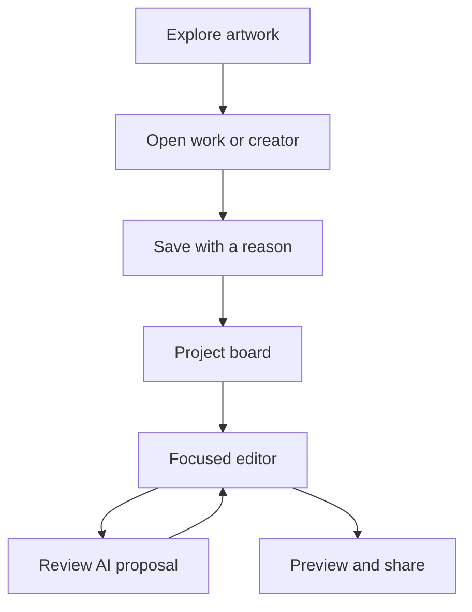

# Simple Kresilo creative workspace

Visitors discover work, save what matters and make something in one focused space. The owner approved all twenty storyboard views and direct implementation on October 21. The approved visual set includes scroll positions, overlays and mobile states, rather than twenty navigation destinations.

Authority: https://github.com/Pukujan/kresilo/issues/12#issuecomment-6324889239. Parent #12 → #1. Leaves #13 saved work, #14 responsive screens, #15 media/motion, #16 verification/delivery; #17 sample collection under #14 and #18 faster motion under #15. Dependencies are recorded on each live issue. Writer Codex; branch codex/kresilo-prototype; merged implementation PR #11. The accepted source is hosted and tested; [delivery report](../DELIVERY_REPORT.md) and [deployment receipt](https://github.com/Pukujan/kresilo/issues/16#issuecomment-6332018141) record the result. The report increment still needs its own gates.

## Stack and boundaries

React 19, TypeScript, Vite, Tailwind and existing shadcn/Radix components; Nitro server. Existing Octo workspace, kresilo_demo only for runtime, kresilo_research read-only. One typed command service handles GUI and terminal. Guest sessions use HttpOnly cookies; optional Google linking keeps guest work. No custom password recovery or second database. Inferhub credentials stay server-only. HyperFrames is integrated as a bounded rendering tool, without adopting OpenDesign's SQLite application.

## Main journey

Explore scrolls from an airy artwork hero to creator-led culture stories and a gallery. Work opens into a detail view; saving carries credit, source and reason to the project. A board leads to a focused editor. AI proposals wait for approval. Motion, history and publication open only when needed.

Navigation: Explore, Projects, You; Create action. Regions are discovery filters; location and creative influences are separate self-described fields. Three labelled fictional sample creators have consistent portraits, work and stories. The owner expanded the original single-creator limit in [sample collection issue #17](https://github.com/Pukujan/kresilo/issues/17). Guided, Explorer and Advanced change assistance within the same project. Recommendations use explicit taste, following and project reference tags; project context takes priority and explanations remain visible.

## Acceptance

Verify desktop and mobile against the approved generated references, not the older hosted interface. Verify resumed guest state, multiple projects, cross-session denial, shared invitation/comment access, conflict handling, manual edits, unapplied proposals, idempotent approval, preserved restore history and redacted publication. Test real model media input and playable MP4 exports before claiming those integrations. Run required MacBook Pro checks and auto-merge only after the final push. Deploy accepted tested code to the existing approved kresilo.design-bakery.com route.

## Current evidence

The accepted implementation merge b636415 is live at https://kresilo.design-bakery.com. Required MacBook Pro CI passed before merge. Twenty source comparisons pass the bounded visual gate. Direct production and host API checks pass persistence, ownership, inert proposals, approval, conflicts, restore, collaboration, imports and redaction. Real image/video model calls and H.264 exports succeeded. All twelve research counts and fingerprints remain unchanged. Hosted browser checks pass a guest reference-to-motion-to-private-preview journey, mobile refresh, actual video playback and Copy link, with no console errors. See [DELIVERY_REPORT.md](../DELIVERY_REPORT.md) for exact revisions, evidence and limits. The report increment has not yet passed its own required gates.

Google configuration and live sign-in are still pending. Guest access remains the owner-approved presentation path. The previous builder runtime is preserved separately from the accepted release. Native Safari/iOS is untested; desktop Chromium viewport checks do not establish native coverage.

## Faster motion

The owner requested the pace of short kinetic-type and collage loops after reviewing [Lina Guerrero’s Spring Show campaign](https://www.linamakesnoise.com/2025springshow). This is visual direction, not copied footage or an integration. [Leaf #18](https://github.com/Pukujan/kresilo/issues/18), parent #15 → #12 → #1, depends on #13/#14/#15/#17. Source correction and measured result: https://github.com/Pukujan/kresilo/issues/18#issuecomment-6331202466.

Quick cuts changes images and title scale every half second. Type punch staggers words within a one-second phrase. Collage shuffle cycles three saved sample images over the base artwork. Quiet drift, rise and still remain available. Three original gallery loops are four-second H.264 files, 540 × 720 at 24 frames per second. The renderer uses local fonts and imagery in a fixed trusted composition, never model-generated HTML. Imported videos inform proposals but are not arbitrary executable compositions.

The first fast-export containers played but contained static/blank frames. That evidence did not establish animation. Removing a duplicated embedded player runtime and placing the timeline inside the timed composition fixed the render. Fresh decoded frames at 0.1, 0.7 and 1.2 seconds visibly differ for all three presets. Gallery pause controls, browser-local reduced-motion preferences and the device preference keep browsing optional. Exports remain explicit actions. A browser-local job pointer reopens the authenticated, Octo-stored result after navigation or refresh; it is not a database or an access credential.

Google configuration and live sign-in remain pending. Guest sessions are the presentation path approved by the owner. Model calls have succeeded for images, imported video and faster-motion proposals; a separate earlier request fell back to labelled prototype guidance, so provider reliability is not claimed. The implementation is accepted and hosted; this report increment still needs its own required CI and merge.
