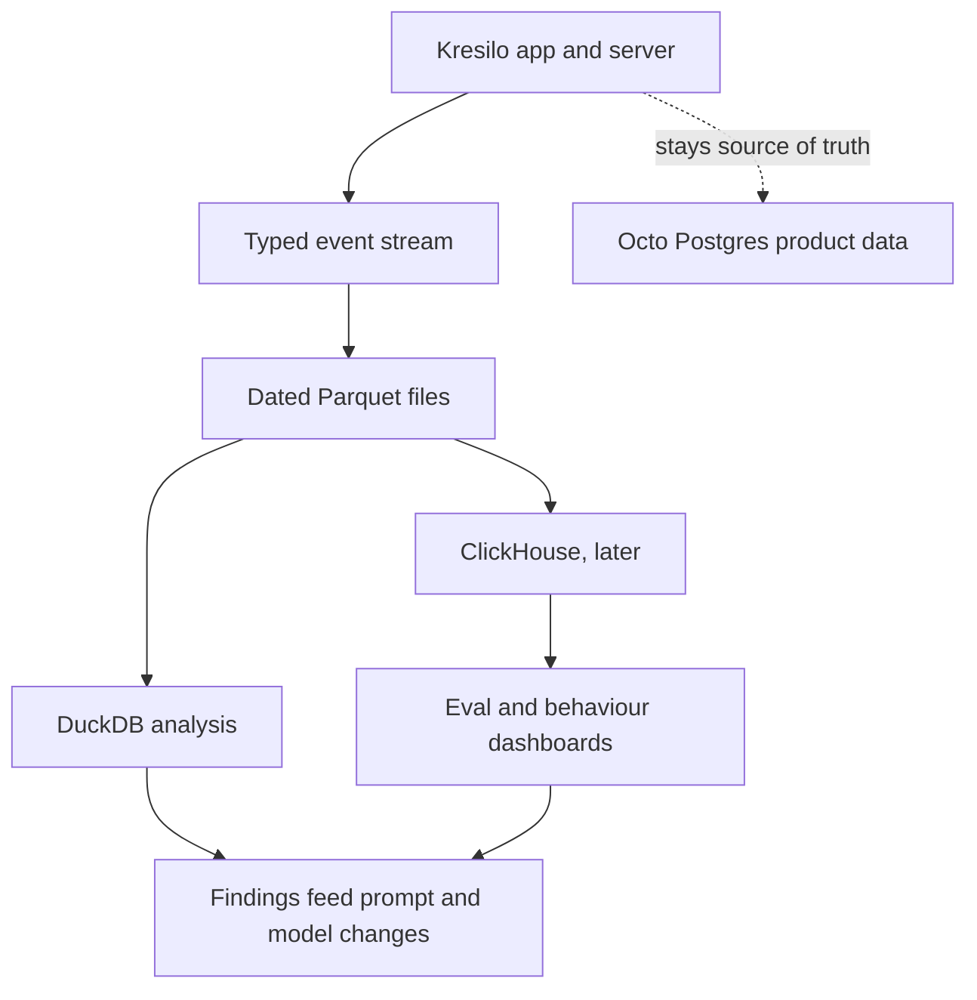

# Kresilo technology: what we use, why, tradeoffs, alternatives, licences, and the proposed analytics roadmap

**Status: the "Proposed" sections are PROPOSALS, not decisions.** Built items describe `origin/main` at b83f3e1 plus this branch, October 22, 2026. A plain version for investors is `Kresilo-tech-stack-investor-overview.pdf` (generated by `scripts/make-investor-pdf.py`). The short inventory is [tech-stack.md](tech-stack.md).

## How to read the evidence

- **Licences** were read from installed package metadata (`node_modules`, 1,885 packages scanned) and from each project's own repository licence file through the GitHub API on October 22, 2026. A licence can change between releases; re-check before relying on any entry in a contract or diligence answer.
- **"Alternatives" and "why not"** are an analysis prepared for this document. They are **not a record of past decisions**: the research schema's `research_decisions` table is empty, and the web stack was inherited from the Dyad builder template (the package is still named `vite_react_shadcn_ts` and includes the Dyad component tagger), not chosen after a written comparison. Where a choice was effectively inherited, this document says so.
- **Not verified:** the weights licences of the hosted language models (accessed only as a service through InferHub), and the commercial terms of Octo and InferHub (the owner's platforms; not assessed here). Web search was unavailable in the authoring session, so no search-sourced claims are made.
- Pricing, performance and cost figures are not stated because none were measured.

## Licence posture in one page

| Finding | Detail |
|---|---|
| Application code dependencies | 75 direct packages. Permissive throughout: MIT (most), Apache-2.0, ISC. |
| One non-OSI licence | GSAP (animation) uses GreenSock's own "Standard no charge" licence. gsap.com states it is now free for everyone, as a Webflow product. It is not an open-source licence; its full terms were not read for this document. |
| Copyleft present | The **FFmpeg binary** that renders video: the Windows binary package is labelled GPLv3, the `ffprobe` binary GPL-3.0, and their JavaScript wrappers LGPL-2.1. Kresilo runs FFmpeg on its own server and does not ship it to users. That is the usual basis for using GPL tools in a hosted service, but it must be re-checked if Kresilo ever distributes a desktop app or installer. The `sharp` image library's Windows build is Apache-2.0 AND LGPL-3.0-or-later (transitive). |
| Source-available, not open source | Remotion (video) and tldraw (canvas), evaluated as alternatives. Both require paid licences for typical company production use. Neither is used. |
| Strong copyleft on candidate analytics tools | Grafana and Plausible are AGPL-3.0; Metabase is AGPL plus a commercial licence for its enterprise folder. Not used. |
| Platform terms | Octo and InferHub are the owner's/third-party services; their terms govern use and are outside this register. |

## Built stack: what, why, tradeoffs, alternatives

| Component | What and why | Tradeoffs | Alternatives considered here (licence) and why not for now |
|---|---|---|---|
| **React 19 + TypeScript** (MIT, Apache-2.0) | Largest UI ecosystem and hiring pool; types catch contract errors between interface and server. Inherited from the Dyad template. | Client-rendered single-page app: weaker for search-engine discovery of public maker pages and story pages unless pre-rendered. | Next.js (MIT): server rendering, heavier framework and hosting model. Svelte/SvelteKit (MIT): smaller bundles, smaller hiring pool and a rewrite. Remix (MIT): similar to React Router's framework mode. None offers a gain that justifies a rewrite of a working prototype. |
| **Vite** (MIT) | Fast dev server and bundler; Nitro plugs in as the server. | Vite 8 is new; plugin ecosystem still catching up. | Webpack, Turbopack: slower or tied to Next. |
| **Tailwind CSS + shadcn/ui + Radix** (MIT) | Accessible primitives you own in the repo; quick consistent styling. Heavy custom CSS also exists in `src/creative/*.css`. | Two styling systems side by side (Tailwind utilities and hand-written CSS) raise maintenance cost. | Material UI, Chakra, Mantine (all MIT): more opinionated visuals, harder to match the editorial Kresilo look. |
| **React Router 6** (MIT) | Simple client routing. | No built-in server data loading. | TanStack Router (MIT): newer. |
| **TanStack Query, zod** (MIT) | Cached server state; one validated command shape for interface and terminal. | Another layer to learn. | Redux Toolkit/RTK Query (MIT): heavier. |
| **Phosphor and Lucide icons** (MIT, ISC) | Large consistent icon sets; icons are a listed priority (P8). | Two icon sets in use; should standardise on one. | Custom drawn set: costly, only worthwhile for brand marks. |
| **GSAP** (GreenSock "no charge" licence) | Timeline animation for motion previews. | Not open source; terms are a vendor's and could change. | CSS animations / Web Animations API (browser standards, no licence); Motion (MIT). Worth revisiting if the licence matters to an acquirer. |
| **Nitro 3, beta** (MIT) | Typed API routes and a deployable Node server in the same repo as the interface. Pinned to a beta (`3.0.260903-beta`). | Beta: breaking changes and thinner documentation; small project risk. | Express (MIT) or Fastify (MIT): mature, more manual setup. Hono (MIT): small and modern. Next.js route handlers (MIT): would pair with a Next rewrite. |
| **Postgres 16 via Octo** (PostgreSQL licence; Octo's own terms) | Relational data with constraints and migrations (`db/migrations`); an existing workspace the owner controls, also holding research data and a knowledge graph. | SQL goes over HTTP with an 8-second timeout. The workspace credential is **not limited to one schema** by the provider, so the isolation to `kresilo_demo` is enforced in server code (`server/utils/octoClient.ts`), not by the database. Media images are stored as base64 rows, which is inefficient at scale. | Supabase (Apache-2.0) or Neon (Apache-2.0): hosted Postgres with scoped roles; adds a vendor and a migration. Self-run Postgres: full control, you operate it. MongoDB/Redis-style stores: source-available licences (SSPL/mixed), not a fit for relational approvals and versions. |
| **HyperFrames 0.8** (Apache-2.0) with headless Chrome and FFmpeg | Renders HTML, CSS and animation to deterministic MP4; the same engine Open Design uses for text-to-motion. | Heavy: needs a browser and FFmpeg on the host; renders are slow compared with page loads. | Remotion (source-available; free only for individuals, non-profits and for-profits up to 3 employees; otherwise a paid company licence). Raw FFmpeg scripts (GPL/LGPL tool): less design flexibility. |
| **FFmpeg and ffprobe binaries** (GPLv3 / GPL-3.0 builds; LGPL wrappers) | Video encoding and inspection. | Copyleft binary: see licence posture above. | A system-installed FFmpeg or LGPL-only build; decide before shipping any desktop package. |
| **google-auth-library** (Apache-2.0) | Google sign-in code is present. | Not switched on: no client credentials configured, and none were simulated. | Auth.js, Clerk, Supabase Auth: more features, new vendor or migration. |
| **Vitest, ESLint, TypeScript** (MIT, MIT, Apache-2.0) | 85 passing tests plus lint and types before each merge. | Browser-level flows are covered by scripts, not a full end-to-end suite. | Playwright Test (Apache-2.0) for end-to-end. |
| **GitHub Actions and GitHub auto-merge** | Required checks before delivery; issue-owned scope. | The CI runner is one machine; if it is offline, delivery waits. | Hosted runners: no single machine, cost and different environment. |
| **Hosting: MacBook Pro, launchd, Cloudflare tunnel** | Zero hosting cost, live at kresilo.design-bakery.com. | A laptop is a single point of failure; no redundancy or monitoring. | A small cloud VM or container host: the natural step before real traffic. |

## Language models

| Role | Model (via InferHub) | Status | Licence and risk |
|---|---|---|---|
| Copilot text proposals | `cb/deepseek-v4.1-flash` | In use | Used as a hosted service; weights licence not verified here. Needs a 2,500-token budget, low reasoning effort and answer normalisation. Deterministic rules are the fallback. |
| Vision proposals from references | `ali/qwen3.8-omni-flash` | In use | Hosted service; weights licence not verified here. |
| Asset quality review | the same vision model | Proposed, untested | As above. |
| Image generation for portraits and assets | An InferHub image model | Proposed, model not chosen | Output-use terms depend on the model chosen; record them when chosen. |
| Development agents | Claude, Codex | Tools used to write code | Not part of the product. |

Risk shared by all hosted models: availability, price and terms are set by the gateway and model providers. The product keeps a deterministic fallback so Copilot degrades rather than fails.

## Proposed: analytics, human evaluation and behaviour data

### Why

Every approval or decline is a person's judgement of whether the AI helped. Today those judgements sit in the product database next to project data and cannot be asked across: which model's proposals get approved, where people give up, which assets are kept. The proposal keeps analytics out of the product database in stages.

### Today vs proposed

| Concern | Today | Proposed |
|---|---|---|
| Product data | Octo Postgres, `kresilo_demo` | Unchanged; remains the source of truth |
| AI provenance | Each proposal records provenance and a cost label (model, tokens, cost) | Same, copied into the event stream |
| Analytics | None | Event stream, Parquet files, DuckDB, then self-hosted ClickHouse |
| Behaviour data | None beyond product tables | Typed events for each meaningful action |

### Layers

| Layer | Role | Licence | Why | Tradeoffs and alternatives |
|---|---|---|---|---|
| **Event stream** | Small typed records of reference kept, proposal approved or declined, edit, undo, error, render, page view. Carries a pseudonymous person key, session, project, model, prompt version, latency, tokens. | Own code | Separates analysis from the product database. | Alternative: a ready product-analytics tool such as PostHog (MIT, with a separately licensed `ee/` folder) gives dashboards sooner but owns the event model. |
| **Parquet files** | Dated, compressed, columnar archive in an open format. | Apache-2.0 | Any later engine reads the same files, so little lock-in. | Alternative: keep events only in Postgres (simple, but slows the product database as volume grows). |
| **DuckDB, first** | Embedded analytical engine reading Parquet directly. | MIT | No server to run, fits single-machine hosting, answers first questions cheaply. | Single machine and limited concurrency. Alternative: a managed warehouse (BigQuery, Snowflake: proprietary, per-query cost). |
| **Self-hosted ClickHouse, later** | Human-based AI evaluation, behaviour monitoring, operational data, improvement loop. | Apache-2.0 (ClickHouse Cloud is a separate commercial service) | Built for many concurrent analytical queries over large event tables; self-hosting keeps data on infrastructure Kresilo controls. | Operational burden: upgrades, backups, monitoring on a machine other than the current laptop. Alternatives: Apache Druid, StarRocks (Apache-2.0): comparable power, smaller communities for this use; TimescaleDB (Apache-2.0 core, Timescale Licence for its `tsl` folder): stays in Postgres but is time-series oriented. |
| **Dashboards** | Views over the above. | Choose later | Superset (Apache-2.0) or Evidence (MIT) are permissive. Grafana and Plausible are AGPL-3.0 and Metabase is AGPL plus a commercial enterprise folder; check network-service obligations before adopting. | |

The same flow in words: the app emits events; events become Parquet files; DuckDB reads them first; ClickHouse is added later from the same files; results guide prompt and model changes; product data stays in Octo.

### Phases

| Phase | What | Exit signal |
|---|---|---|
| 1 | Define the event schema; record events to local files; no new infrastructure | Create, propose, approve, decline, edit and error events flow reliably |
| 2 | Close files to Parquet; query with DuckDB; first model-comparison report | One repeatable report the team uses |
| 3 | Capture reviewer ratings against a simple rubric (relevance, grounding in the person's own references, taste) | Enough rated proposals to separate two models |
| 4 | Stand up self-hosted ClickHouse, load history from the Parquet files, build dashboards | Dashboards used weekly and DuckDB on files has become the bottleneck |

Thresholds between phases are deliberately not set; decide them with real event volume.

## Other candidates reviewed (not adopted)

| Candidate | Licence | What it offers | Why not (for now) |
|---|---|---|---|
| Open Design (`nexu-io/open-design`) | Apache-2.0 | Local-first agent design workspace: 171 skills, 154 design systems, 116 design templates, text-to-motion through HyperFrames, edit-mode and sketch tools | A heavy daemon with its own SQLite store and agent runtime, not a library. Its motion engine is the HyperFrames Kresilo already ships. Whether its canvas can be extracted is unverified. Some bundled content is third-party (brand design-system packages, HeyGen catalogue thumbnails), so reuse needs a per-asset check. |
| tldraw | tldraw licence (source-available) | Ready infinite canvas | Production use requires a paid licence key and shows a watermark otherwise. |
| Excalidraw, Fabric.js, Konva | MIT | Open canvas libraries | Would be candidates if Kresilo builds a richer canvas than the current layer editor. |
| Penpot | MPL-2.0 | Whole open-source design tool | An application, not a component. |
| Remotion | Source-available (company licence above 3 employees) | React-based video | See built-stack table. |
| Figma/Canva | Proprietary | Incumbent design products | Competing products, not components; not assessed. |

## Provenance and open questions

1. **Decision record gap.** No recorded technology decisions exist. If investors ask "what did you evaluate", the honest answer is this document's analysis, dated October 22, 2026.
2. **Retention and identity** for analytics events (hashing, expiry of guest data) are undecided.
3. **Model licences** and **Octo / InferHub terms** need an owner-supplied statement before diligence.
4. **FFmpeg packaging** needs a decision before any desktop or installer distribution.
5. **Hosting** on one laptop is the main operational risk to resolve before real traffic.

## Next action

Owner reviews this document. If the analytics direction is accepted, file the event schema (phase 1) as its own issue under parent #12, then #1.
