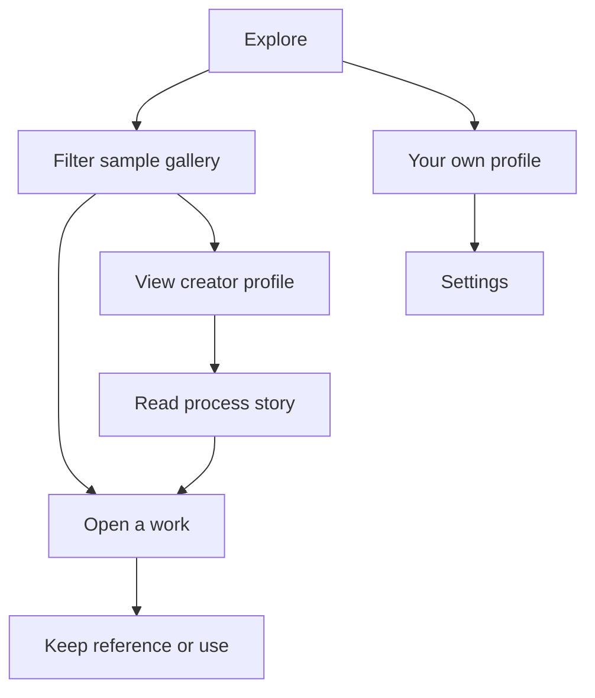
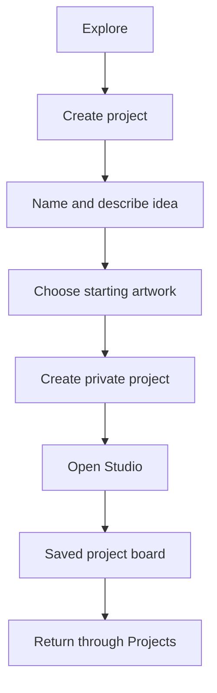
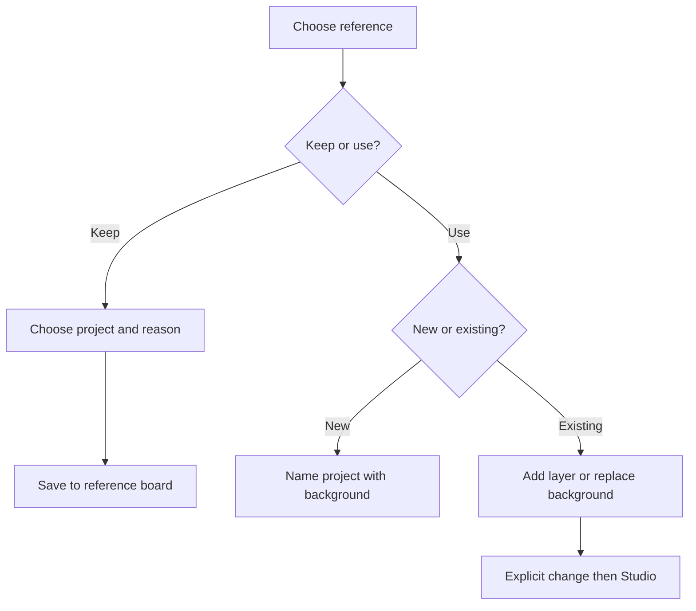
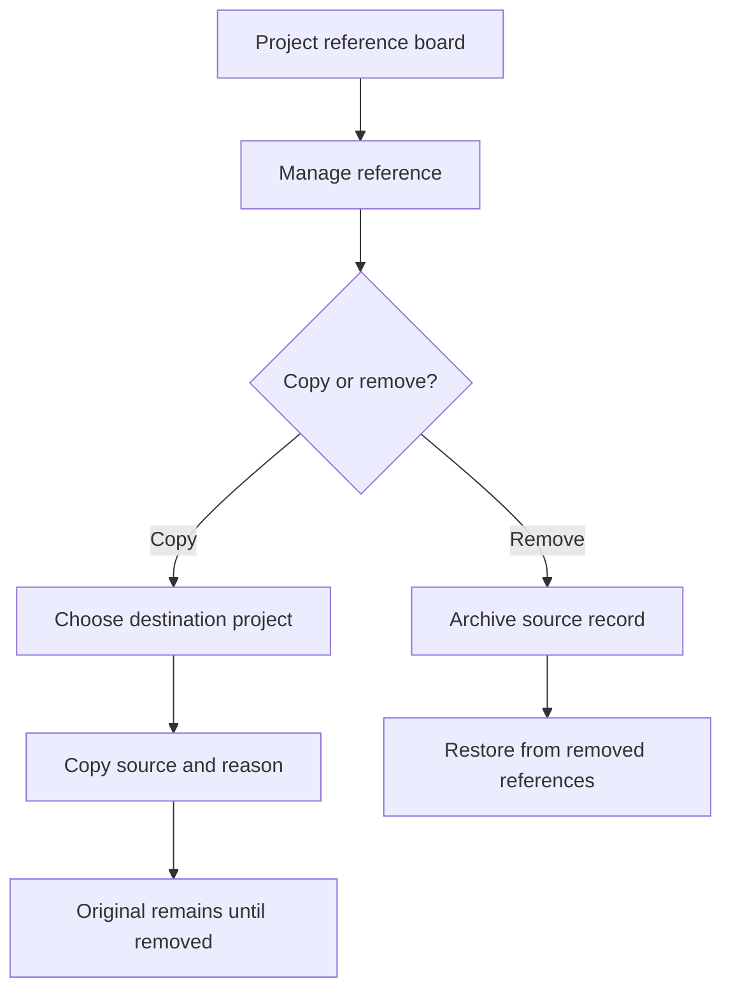
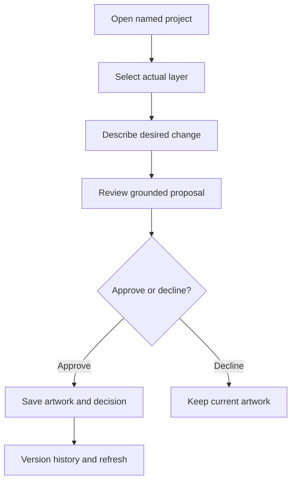
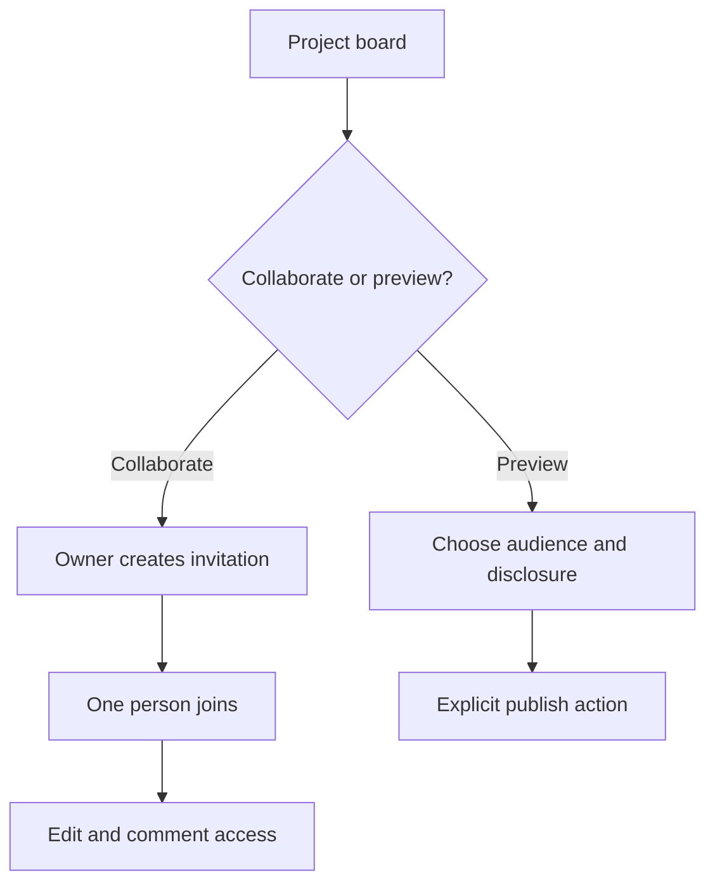
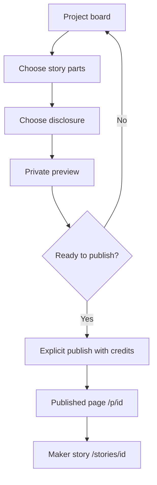

# People need to know where their ideas go

This map describes the corrected prototype flow deployed at https://kresilo.design-bakery.com from accepted source db5e442 through PR #26. [The owning reference-to-Studio issue](https://github.com/Pukujan/kresilo/issues/20) records exact checks and release receipts; [hosted acceptance](qa/project-flows/hosted-project-flow-acceptance.json) records artifact identity and observed behavior. The evidence-only report increment has separate required checks.

Leaf #20; parent #12 then #1; dependencies accepted reference/media/motion work #14/#15/#18 and hosting setup #8. Task KRES-0010; primary writer Codex; branch `codex/clear-project-flows`. [The owner correction](https://github.com/Pukujan/kresilo/issues/20#issuecomment-6348041117) authorizes the audit fixes and these maps.

## Find a reference and its context

| Surface | Route | Meaning |
|---|---|---|
| Discovery | `/` and `/#gallery` | Browse and filter work by search, creator, discipline and still/motion. |
| Work | `/work/:id` | Inspect one image, source and maker; choose collecting or canvas use. |
| Maker | `/people/:id` | A labelled fictional sample creator's work and process. This differs from your own profile. |
| Process | `/stories/:id` | Read sample creative context before choosing a work/reference. |
| Your profile | `/me` | Your own page: name, your projects and the references you kept, with a link to settings (observed in `src/creative/Workspace.tsx`, merged in PR #28). This differs from a sample maker's page at `/people/:id`. |
| Settings | `/you` | Current guest/account identity, preferences (including the three help levels) and browser recovery limits. Preferences do not edit artwork. |

## Create and return

| Step | Route or action | State and expectation |
|---|---|---|
| Explore | `/` | Discovery filters choose references, not a project destination. |
| Create | `/create` | Required name/brief and visible starter explain what opens. No implicit image generation. |
| Save | `project.create` | Server creates a private project in the existing workspace; initial immutable artwork version exists. |
| Edit | `/studio/:id` | Project name identifies the destination. New route resets project-local editor drafts. |
| Return | `/projects` → `/projects/:id` | Board separates References from Current artwork; Rename changes project identity, not poster lettering. |

Guests see the browser/cookie lifetime limit before creation and near their identity on the settings page. Google access is offered only when configured. A profile name alone does not provide recovery. The profile is `/me`; the settings page that explains the browser lifetime limit is `/you`.

## Collect or use a reference

| Choice | Route or command | Result |
|---|---|---|
| Keep as reference | `/work/:id`, `reference.carry` | Adds source, creator and reason. Canvas unchanged. A new destination uses `project.create` first. |
| Use in new project | `project.create` with source | Named project starts with the image as background and its source retained. |
| Use in existing project | `reference.carry` then revision-checked `artwork.edit` | Default is a new independent image layer. Replacing the background is a separate explicit choice. |
| Already collected | Skip duplicate carry | The existing source/reason remains; placing it is a separate canvas operation. |
| Uncertain network save | Refresh and inspect | Prevent another blind canvas addition or project creation. A reference can be saved even when the later canvas edit fails. |

## Correct an assignment

| Action | Command | Safety boundary |
|---|---|---|
| Rename project | `project.rename` | Revision checked; artwork and versions unchanged. |
| Copy reference | `reference.copy` | Both projects must be accessible. Destination revision checked. Duplicate source rejected. Neither canvas changes. |
| Move reference | Copy, verify, then remove | Deliberately two explicit actions; no claim of atomic cross-project movement. Imported files remain project-scoped. |
| Remove from board | `reference.remove` | Source retained in `referenceArchive` for earlier decisions and credits. Artwork unchanged. |
| Restore reference | `reference.restore` | Restores archived source/reason; revision and duplicate checks apply. |

## Edit a layer with a prompt

| Step | Command or UI | State transition |
|---|---|---|
| Add image | Layers → Add image layer | Opens asset selection. No layer exists until an asset saves successfully; prompting is disabled in this mode. |
| Select target | Title, Caption, Background or image id | Editing and prompting name the same target. Switching targets clears the previous prompt draft. |
| Ask | `proposal.request` | Saves a grounded proposal, not an artwork mutation. Provider guidance is labelled according to actual provenance. |
| Decide | `proposal.accept` / `proposal.reject` | Accept checks current artwork version, mutates and records decision/version/history. Decline keeps artwork unchanged. |
| Recover | `version.undo`, `version.redo`, `version.restore` | Saved artwork/motion navigation preserves immutable snapshots; new edits clear redo. |
| Reload | `workspace.get`, `project.get` | Server records return. Client merges project revisions so late responses do not replace newer saved state. |

## Sharing has a separate meaning

| Choice | Mapping | Limit |
|---|---|---|
| Invite to edit | `project.invite` → `/join/:token` → `project.join` | One-person invitation expires after seven days. It shares access; it does not assign responsibility, ownership or a deadline. |
| Private preview | Studio sharing flow | Opening the dialog does not publish. The owner chooses audience before an explicit `publication.create`. |
| Imported media | Server publication guard | Private imported canvas images cannot be published by this prototype. |

## Tell the story (PROPOSAL, not built)

Status: proposal from [the people-first plan](people-first-plan.md). Today the preview page lets the owner write a description, choose an audience and create a link, and the published page `/p/:id` shows the artwork, description, creator and credits. It does not yet show reasons, decisions, versions or who made which step. The proposal below adds the story. Full detail lives in [designer-story-spec.md](designer-story-spec.md); people and journeys in [people-and-journeys.md](people-and-journeys.md).

| Step | Route or command | Meaning |
|---|---|---|
| Choose story parts | `/preview/:id` (extended) | Pick the goal, which references and reasons, which decisions, which before and after versions. Every part comes from a stored record. |
| Choose disclosure | `/preview/:id` (extended) | Audience and per-part visibility. Credits and the authorship strip cannot be hidden. Declined directions are hidden unless chosen. |
| Private preview | `/preview/:id` | Opening it does not publish. |
| Publish | `publication.create` | Explicit action. Imported private media still cannot be published. |
| Read | `/p/:id`, `/stories/:id` | Viewer sees the goal, credited references with reasons, decisions, before and after, and the authorship strip: hand, AI-assisted or AI-generated, with the tool named. AI work is never shown as hand work. |

All writes use the shared typed command service and the same existing Octo runtime namespace. No separate database, automatic publication or client-side credential configuration is introduced. The combined hosted flow and exact artifact have been verified; live issue receipts own acceptance of the separate release-report increment.

The six original diagrams were rendered with Mermaid CLI 12.0.0 and visually inspected. The [official CLI documentation](https://github.com/mermaid-js/mermaid-cli/tree/12.0.0) describes Markdown diagram extraction. Rendering is a local documentation check; this tool is not an application dependency.
